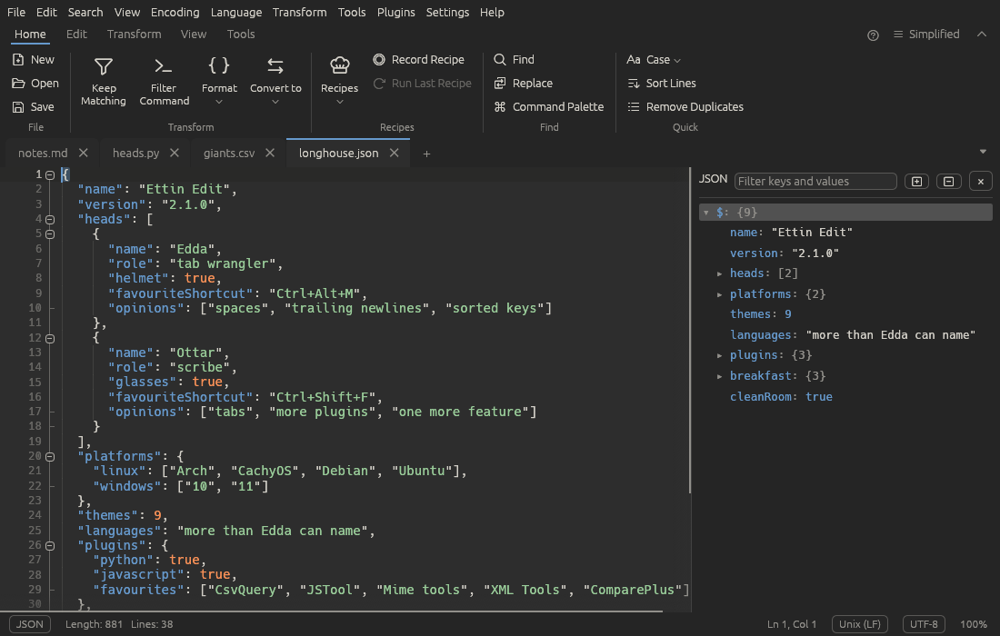
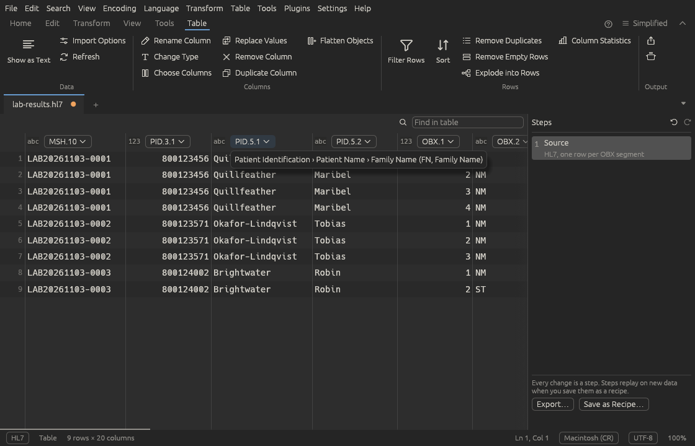

<p align="center">
  
</p>

<h1 align="center">Ettin Edit</h1>

<p align="center">
  <b>A text editor with two heads, because one opinion about tabs was never enough.</b><br>
  Built for turning one system's text into another's: reshape exports, convert formats,<br>
  clean up logs and save the steps as a recipe. Free of Notepad++ code. Runs on Linux and Windows.
</p>

<p align="center">
  <a href="https://github.com/Tharkis/Ettin-Edit/releases/latest"></a>
  
  <a href="LICENSE"></a>
  
  
</p>

<p align="center">
  <a href="#whats-new">What's new</a> ·
  <a href="#install">Install</a> ·
  <a href="#what-it-does">Features</a> ·
  <a href="#from-the-command-line">Command line</a> ·
  <a href="#plugins">Plugins</a> ·
  <a href="#building">Build</a> ·
  <a href="FEATURES.md">Full feature list</a>
</p>

---

## What's new

<!-- Keep this to the latest two releases: each release adds itself at the top and drops the oldest. -->

**[2.8.0: Nested data and HL7](https://github.com/Tharkis/Ettin-Edit/releases/tag/v2.8.0)**

- HL7 v2 messages open as a table, one message or one result (such as OBX) per row, with field names like `PID.5.1` explained when you point at a column.
- Nested JSON and XML open as tables too: pick which list becomes the rows, and the fields above it come along.
- New **Explode into Rows** and **Flatten Objects** steps.
- Export as nested JSON, YAML, XML, or HL7 messages from a template.
- Made-up [sample files](samples/tables) to try it on.

**[2.7.0: Table view](https://github.com/Tharkis/Ettin-Edit/releases/tag/v2.7.0)**

- Open Excel workbooks, CSV and JSON as a table with typed columns (<kbd>Ctrl</kbd>+<kbd>Alt</kbd>+<kbd>T</kbd> switches any text tab).
- Every change (rename, retype, filter, sort, clean up, remove duplicates) is a step you can switch off, change or reorder.
- Export to CSV, `.xlsx`, JSON, JSON Lines or Markdown.
- Save the steps as a recipe and run it on next week's export, even from the command line.

Older releases are listed in [FEATURES.md](FEATURES.md#release-history) and on the [releases page](https://github.com/Tharkis/Ettin-Edit/releases).

## Meet the heads

In Norse myth an *ettin* is a giant, and the famous ones had more than one head.
Ours has two, and they share one body, one tunic and, sadly, one breakfast bowl.

- **Edda** (left, helmet) keeps your tabs in order, your indentation straight and
  your JSON sorted. She has never once lost an unsaved file and would like you to
  know it.
- **Ottar** (right, glasses) writes everything down, compares everything with
  everything else and keeps asking for one more plugin.

They argue a lot. You get an editor that does both.



## What it does

Ettin Edit is for people who spend their day turning one system's output into
another system's input: log files, CSV and JSON exports, Excel workbooks, XML and
HL7 messages. Every change is a transform you can preview before it touches
anything, and any list of them can be saved as a recipe and run again on next
week's file, even from the command line.

Underneath it's a complete clean-room editor inspired by Notepad++, with built-in
versions of the Notepad++ plugins people install first. It draws its own window
with [egui](https://github.com/emilk/egui), so it looks the same on every platform.

| | |
| --- | --- |
| 🔁 **Transform first** | Everything that changes text lives in one Transform menu: pipe it through any shell command, keep or drop matching lines, sort, count duplicates, number lines, reflow paragraphs, change case (camelCase, snake_case…), pull regex matches into a new tab, line up columns, pick, drop and sort fields of CSV or log lines, join lines into a quoted list for SQL `IN (…)`, escape strings for JSON, C, SQL, regex or the shell, turn Unix times into dates, convert to JSON, YAML, TOML, XML, CSV or a Markdown table (it works out what you have), Base64, URL and HTML encoding, hashes, hex, JWT, and JSON and XML formatting. The toolbar's Home tab and the right-click menu put the transforms that fit your text first. |
| 👀 **Try before you apply** | Keep Matching Lines paints the lines that stay green and the ones that go red as you type; the other transform dialogs show Input and Output side by side, and Filter Through Command previews a shell command before it touches anything. Send any result to this tab, a new tab or the clipboard. Open a one-line JSON file and a bar offers to format it (also for tokens, Base64, CSV and mixed line endings). |
| 🧮 **Tables** | Open an Excel workbook, a CSV, a JSON or XML export or a file of HL7 v2 messages as a table, like a spreadsheet for structured data. Typed columns, dates read the way they were written (`DD/MM/YYYY`), filters, sorting, renames and value clean-up, each a step you can switch off or change. Pick the rows out of a nested JSON or XML tree, explode lists into rows, and read HL7 one message or one result per row, with each field's name when you point at a column. Export as CSV, `.xlsx`, nested JSON, YAML, XML, HL7 from a template or Markdown, and save the steps as a recipe for next week's export. Made-up [sample files](samples/tables) to try it on are included. |
| 🍳 **Recipes** | Save a list of Transform steps (find and replace, keep lines, sort, trim, convert, encode, even shell commands) under a name, watch a live preview after any step, on the open tab or on sample text saved with the recipe, or record one by doing the job once. Run it on a selection, every open tab, or from the command line (`ettin-edit --recipe "Tidy Whitespace" *.txt --in-place`). Recipes are plain JSON files you can share. |
| 📊 **CsvQuery** | Run SQL against the CSV you have open, join it with other open tabs and sort the results. Your spreadsheet would like a word. |
| 🧰 **Tools menu** | Tools that look without changing: a live JSON tree and JSON validation (JSTool), XPath, XML syntax checks, XSD/DTD validation and XSLT (XML Tools). |
| ⚖️ **Compare** | Two tabs, the last save, the clipboard or your last Git commit, with word-level highlights and moved blocks (our take on ComparePlus). |
| ✍️ **A proper editor** | Tabs, split view, multiple carets, column editing (with a Column Mode), code folding that follows the grammar, keyword completion, parameter hints, macros, bookmarks, auto-close and smart indent. Opens a 50 MB file in about a second, and word wrap keeps up when you resize the window. |
| 🔎 **Finds things** | Find and replace with regex or extended escapes (`\n`, `\r\n`, `\t`, `\x41`), Find All in open tabs, Find in Files in the background, marks and a results panel. |
| 🌍 **Text in any shape** | About 80 languages, plus your own from the **Define Language** form or a short `.lang.json` file. UTF-8, UTF-16 and legacy code pages, every line ending, Chinese, Japanese and Korean text. |
| 🧭 **Panels** | Function list, document map, a folder workspace, a character panel with every Unicode name, a Markdown preview that scrolls with the text and shows images, a hex view that edits any byte and opens binary files of any size, and a command palette on F1 that puts your recent commands, recipes and plugin commands first. F11 hides everything except your words. |
| 🧩 **Plugins in Python or JavaScript** | Your choice. Add transforms that work like the built-in ones (preview, options, one undo step, recipe steps), commands, shortcuts, toolbar buttons and panels, and install them from Plugins > Manage Plugins. Plugins > New Plugin… writes one to start from and reloads it as you save. |
| 🎨 **Looks good in the dark** | Nine themes (Ettin Dark is the default), every one an editable file, plus a colour editor with ten named colours (Comments, Strings, Keywords…), *What colours this?* and window colours. Drop in any `.tmTheme` you like. |
| 🎛️ **A toolbar you arrange** | Office-style tabs of buttons for the commands you use most. Drag any menu command, macro or plugin command onto it, pick icons and labels, switch to a one-row simplified toolbar, or collapse it out of the way. Hide the toolbar, the menu bar or both for a cleaner window (tap Alt to reach the menus). |
| ⌨️ **Yours to bend** | A searchable Preferences window where changes apply at once (with Undo Changes), light/dark themes that follow your desktop, per-language indentation, Notepad++ or VS Code keys plus two-key chords like Ctrl+K S, resizable dialogs, settings files that reload as you save them, and Export/Import Settings to take it all to another computer. |
| 🛟 **Doesn't lose your work** | Sessions and backups of unsaved changes come back after a crash, a reboot or a cat on the keyboard. |
| 🗣️ **Speaks your language** | English, plus Deutsch, Français and Español (machine-translated for now, corrections welcome), following your system's language. Add your own with one text file. |



Everything that works today, and the few things that don't yet, is ticked off in
[FEATURES.md](FEATURES.md).

## User manual

The [Ettin Edit User Manual](https://tharkis.github.io/Ettin-Edit/) explains every
part of the editor and how to make it your own. It's also built into the app, so it
works offline: Help > User Manual, or <kbd>Shift</kbd>+<kbd>F1</kbd>.

## Install

Grab the latest build from the
[releases page](https://github.com/Tharkis/Ettin-Edit/releases/latest):

| You're on | Get this | Then |
| --- | --- | --- |
| **Windows** | `setup.exe` (no admin rights needed), or the `.zip` | Run it |
| **Arch / CachyOS** | `.pkg.tar.zst` | `sudo pacman -U ./ettin-edit-*.pkg.tar.zst` |
| **Debian / Ubuntu / Zorin OS** | `.deb` | `sudo apt install ./ettin-edit_*_amd64.deb` |
| **Fedora / openSUSE** | `.rpm` | `sudo dnf install ./ettin-edit-*.x86_64.rpm` (or `zypper install`) |
| **Any Linux (Flatpak)** | `.flatpak` | Open it in your software centre, or `flatpak install --user ./ettin-edit-*.flatpak` |
| **Any Linux (AppImage)** | `.AppImage` | Make it executable and run it |
| **Any other Linux** | `.tar.gz` | Extract it and run `./ettin-edit` |

Help > Check for Updates tells you when a newer one is out, and **Update Now** downloads
it, checks it against GitHub's checksum and installs it (packages ask for your password),
then restarts Ettin Edit ([details](https://tharkis.github.io/Ettin-Edit/installing.html#updating)).
The `.deb`, `.rpm` and `.flatpak` also add Ettin Edit's own package repository, so your
software updater (or `flatpak update`) installs new versions for you too, and every package
shows its licence, website and release notes in software centres
([why a downloaded `.deb` file's page doesn't](https://tharkis.github.io/Ettin-Edit/installing.html#why-a-downloaded-deb-shows-unknown-licence)).

To build the Arch package yourself from a checkout:

```sh
cd packaging/arch
makepkg -si
```

## From the command line

Recipes run without opening a window, so a job you set up once by hand can go in a
script or a scheduled task:

```sh
ettin-edit --list-recipes                                      # what's saved
ettin-edit --recipe "Tidy Whitespace" *.txt --in-place          # change files where they are
ettin-edit --recipe "Ward report" export.csv > report.json      # result to standard output
ettin-edit --recipe "Ward report" export.xlsx --out report.xlsx # result to a file (needed for .xlsx)
some-command | ettin-edit --recipe "Mask IDs" > masked.txt       # no files: reads standard input
```

A recipe with shell command steps only runs them with `--allow-commands`. Without
`--recipe`, the files you name open in the window as usual
([details](https://tharkis.github.io/Ettin-Edit/recipes.html#from-the-command-line)).

## Plugins

Write a plugin in whichever language you already know. This one adds a transform that
shouts the text back at you:

```python
import ettin

@ettin.transform("Shout", options={"marks": "!"})
def shout(text, options):
    return text.upper() + options["marks"]

ettin.run()
```

It appears in Transform > Plugin Transforms and the command palette, runs on every
selection as one undo step, previews its result, asks for its options, and can be a
recipe step, even from the command line. Plugins can also read and change text, open
and save files, react to events, mark text, show panels with trees, tables and forms,
and add commands that can go on the toolbar. Plugins > New Plugin… writes one to start
from; Plugins > Install Sample Plugins gives you four to poke at, including the HL7
Viewer, and the
[plugin guide](https://tharkis.github.io/Ettin-Edit/plugin-guide.html) covers the rest.

## Themes

Ettin Edit ships with nine themes. Ettin Dark, the default, is based on Base16 Eighties;
Ettin Night and Ettin Light are its own; the rest are classic schemes bundled with syntect.
All of them live as TextMate `.tmTheme` files in the themes folder, so you can change
any colour and pick **View > Theme > Reload Themes** to see it, or use
**View > Theme > Edit Theme Colours** for a live preview: its Simple view changes Comments,
Strings, Keywords and seven more by name in every language, and *What colours this?* tells
you which colour and rule a word uses. Any other `.tmTheme` file you
put there appears under **View > Theme > Custom**. **View > Theme > Restore Built-in Themes** puts the
originals back and keeps your edited copy as `<name>.tmTheme.bak`.

- Linux: `~/.config/EttinEdit/themes/`
- Windows: `%APPDATA%\EttinEdit\themes\`

A built-in theme you haven't edited is updated when Ettin Edit is; one you have edited is
left alone.

## Building

Install Rust (https://rustup.rs), then:

```sh
cargo run --release -- path/to/file.txt   # run
cargo build --release                     # binary in target/release/
cargo test                                # unit tests
```

**Linux** needs the usual desktop libraries at run time (OpenGL, `libxkbcommon-x11` on X11).
On Debian/Ubuntu: `sudo apt install libxkbcommon-x11-0 libgl1`.

**Windows** builds with the normal MSVC toolchain (`cargo build --release`), or can be
cross-compiled from Linux with `rustup target add x86_64-pc-windows-gnu` and the MinGW linker
(`cargo build --release --target x86_64-pc-windows-gnu`).

## FAQ

**Is this Notepad++?** No. It's inspired by Notepad++ and shares none of its code.
Every line was written from scratch for Ettin Edit.

**Why two heads?** One to write the code and one to review it. Also because the
name was free.

**Does it run on Windows?** Yes, and on Linux, from the same code. Edda prefers
Linux. Ottar won't say.

**Can I use it at work, fork it or ship it?** Yes. Ettin Edit is MIT licensed, so
you can use, change and share it freely as long as you keep the copyright notice.
See [LICENSE](LICENSE). The toolbar icons are [Phosphor](https://phosphoricons.com/)
(MIT licence, © Phosphor Icons).

**Who gets the spoon?** Still being decided. Please don't open an issue about it.

<details>
<summary><b>Where things live in the code</b></summary>

| File | What it does |
| --- | --- |
| `src/main.rs` | Entry point: window setup, files from the command line |
| `src/app.rs` | The window: menus, tabs, editor, status bar, dialogs |
| `src/actions.rs` | Every command and its keyboard shortcut. Menus, shortcuts and plugins go through this list |
| `src/document.rs` | Loading, saving and reloading files: encodings, line endings, changes on disk |
| `src/encoding.rs` | Encoding detection, decoding and encoding (UTF-8, UTF-16, legacy code pages) |
| `src/session.rs` | The session and backups of unsaved changes |
| `src/instance.rs` | Single-window mode: hands files to the Ettin Edit already running |
| `src/raise.rs` | Brings that window to the front (Windows foreground rights, X11 `_NET_ACTIVE_WINDOW`, Wayland activation tokens) |
| `src/system.rs` | Opening the file manager and a terminal, and reading the last Git commit |
| `src/file_ui.rs` | Rename, move to trash and summary dialogs, the changed-on-disk bar, the Encoding menu |
| `src/editor/` | The editor engine: `buffer.rs` (rope text and undo), `invisible.rs` (labels for invisible characters), `selection.rs` (carets), `layout.rs` (columns, word wrap, row index), `highlight.rs` (incremental highlighting), `find.rs` (find, replace, marks, bookmarks), `lines.rs` (line operations, case, comments), `smart.rs` (auto-close, smart indent, completion, brace matching, column editing), `fold.rs` (code folding), `fold_scan.rs` (grammar-aware fold regions, scanned in the background), `hints.rs` (parameter hints), `view.rs` (drawing, keyboard and mouse) |
| `src/search.rs` | Search queries (plain, extended escapes, whole word, regex), replacement templates, and Find in Files |
| `src/search_ui.rs` | The find bar, results panel, and the Go to Line and Find in Files dialogs |
| `src/tools_ui.rs` | The Column Editor and macro dialogs |
| `src/tools/` | The text tools behind the Transform and Tools menus: `transform.rs` (keep or remove lines, count distinct, prefix and suffix, number lines, reflow, hashes, hex, JWT), `fields.rs` (extract matches, align columns, fields, split and join, escapes, Unix times), `convert.rs` (JSON, YAML, TOML, XML, CSV and Markdown tables), `pipe.rs` (running shell commands), `mime.rs` (Base64, URL, quoted-printable, HTML, SAML), `json.rs` (JSON parser, formatter and tree), `js.rs` (JavaScript formatter and minifier), `xml.rs` (pretty print, linearize, syntax check, XPath at the caret), `xpath.rs` (XPath 1.0), `csv.rs` (reading delimited text), `sql.rs` (CsvQuery's SQLite tables and queries) |
| `src/csv_query.rs`, `src/app/csv_query.rs` | The CsvQuery panel, its background query thread, and which tabs are tables |
| `src/text_tools_ui.rs` | The JSON tree and XPath panels, and the notices tools show |
| `src/menu.rs`, `src/app/menus.rs` | Menus as data, so the Edit, Transform and Tools menus are drawn in both the menu bar and the right-click menu |
| `src/transform_ui.rs`, `src/app/transform.rs` | The Transform dialogs, their previews and Result goes to, and running shell commands |
| `src/suggest.rs`, `src/app/suggest.rs` | The suggestion bar's detectors (one-line JSON and XML, JWT, Base64, CSV, mixed line endings and indentation) and the bar |
| `src/app/welcome.rs` | The Welcome tab, What's new (release notes from the metainfo) and the guided tour |
| `src/fields_ui.rs` | The settings form of the Columns and Fields commands, shared by their dialogs and the Recipes window |
| `src/app/convert.rs` | Working out which format a tab is in, and the Convert to and Read as menus |
| `src/recipes.rs`, `src/app/recipes.rs`, `src/recipe_ui.rs` | Recipes: the steps and their runner, running and recording them in the app, and the Recipes window |
| `src/cli.rs` | Running a recipe from the command line (`--recipe`, `--list-recipes`, `--in-place`, `--out`) |
| `src/table/` | The table engine: `mod.rs` (typed columns), `import.rs` (CSV, workbooks, JSON, XML and HL7 into a table), `hl7.rs` and `hl7_dict.txt` (the HL7 v2 reader, writer and field names), `pattern.rs` (date patterns), `steps.rs` (the steps), `export.rs` (CSV, `.xlsx`, JSON, YAML, XML, HL7 and Markdown), `job.rs` (a whole job, as kept in a recipe) |
| `src/table_ui.rs`, `src/app/tables.rs` | The table tab: the grid, the Steps panel and the dialogs, and opening workbooks and text as tables |
| `samples/tables/` | Made-up sample data (HL7, JSON, XML, CSV) for trying tables and for the tests |
| `src/transforms.rs` | The transform catalogue: every command that changes text, in the groups the Transform menu, the right-click menu and the recipe window's Add Step all use |
| `src/app/text_tools.rs` | Runs the text tools on the current document |
| `src/app/views.rs` | Split view: which tabs are in which view, moving and cloning tabs, the divider |
| `src/compare.rs` | The compare engine: line alignment, options, moved lines, word changes, unified patches |
| `src/compare_ui.rs`, `src/app/compare.rs` | The Compare tab, and starting and refreshing comparisons |
| `src/plugins/` | The plugin host: `mod.rs` (starting plugins, messages, commands, transforms, events), `manifest.rs` (`plugin.json`, its options, finding plugins, the permission fingerprint), `process.rs` (plugin processes), `shortcut.rs` (shortcut text), `panel.rs` (JSON panels), `ui.rs` (Manage Plugins, Options, the log and the permission prompt), `data.rs` (plugin settings), `headless.rs` (running plugin transforms for recipes and the command line), `new_plugin.rs` (New Plugin…) |
| `src/app/plugins.rs` | Answers plugin calls on the open documents, sends events, draws plugin panels, marks and status items, reloads changed plugins |
| `src/app/plugin_transforms.rs`, `src/plugin_transform_ui.rs` | Running plugin transforms on the selections, and their dialog |
| `src/app/markdown_preview.rs` | View > Markdown Preview |
| `plugins/sdk/` | The Python and JavaScript SDKs that plugins import, and their type hints (`ettin.pyi`, `ettin.d.ts`) |
| `plugins/samples/` | The sample plugins: Text Statistics (Python), Markdown Outline (JavaScript), Markdown Preview (plugin example, Python) and HL7 Viewer (Python; `hl7.py` parses messages, `hl7_defs.py` is the HL7 v2.5.1 dictionary) |
| `src/macros.rs` | Macro recording and playback steps |
| `src/ribbon.rs`, `src/ribbon_ui.rs`, `src/ribbon_dialog.rs`, `src/app/ribbon.rs` | The toolbar: its layout, drawing it, Customise Toolbar, and which commands it can show |
| `src/i18n.rs`, `assets/i18n/` | Translations of the interface (Fluent `.ftl` files) |
| `src/a11y.rs` | Names for screen readers of buttons that show only an icon |
| `src/dialog.rs` | Helpers for resizable dialogs |
| `src/startup_window.rs` | Opening maximized without a flicker on Windows |
| `src/prefs_ui.rs`, `src/shortcut_ui.rs`, `src/style_ui.rs` | Preferences, the Shortcut Mapper and the theme colour editor |
| `src/theme_simple.rs` | The Simple theme colours, What colours this? and highlighted previews |
| `src/lang_dialog.rs` | Language > Define Language (the form, its preview and `.lang.json` round trip) |
| `src/palette_ui.rs`, `src/app/commands.rs` | The command palette and tab list, and the list of every command |
| `src/folder_ui.rs`, `src/function_list_ui.rs`, `src/editor/map.rs`, `src/app/panels.rs` | The folder panel, function list and document map |
| `src/function_list.rs` | Finding functions, classes and headings in about 40 languages |
| `src/user_lang.rs`, `src/app/languages.rs`, `assets/syntaxes/` | User-defined languages (`.lang.json` to a grammar) and the extra built-in grammars |
| `src/lang_api.rs`, `assets/api/` | Keyword and function lists for completion and parameter hints, and the user's own lists in the `api` folder |
| `src/tools/xsd.rs`, `src/tools/dtd.rs`, `src/tools/xslt.rs`, `src/app/xml_schema.rs` | XSD and DTD validation and XSLT 1.0 |
| `src/print.rs`, `src/app/printing.rs` | Printing and HTML export |
| `src/hex.rs`, `src/hex_ui.rs`, `src/bytes.rs` | Hex View: a tab's bytes as saved, turning byte edits back into text, and the piece table that holds binary and very large files |
| `src/char_panel.rs` | The Character Panel: Unicode blocks, names, HTML entities and search |
| `src/update.rs` | Checking GitHub for a newer release |
| `src/self_update.rs` | Downloading, checking and installing an update |
| `src/plugins/store.rs` | The plugin manager: the plugin index, downloads and safe installs |
| `docs/manual/`, `src/manual.rs` | The user manual (mdBook sources, also built into the app) and its in-app viewer; see `docs/manual/README.md` |
| `src/highlight.rs` | Language list and detection (syntect grammars) |
| `src/fonts.rs` | The editor font, installed fonts, and fallback fonts for Chinese, Japanese and Korean text |
| `src/theme.rs` | Built-in and custom themes: copying the built-ins to the themes folder, loading them, and the window colours derived from them |
| `src/settings.rs` | Settings, recent files and session, saved as JSON |
| `src/watch.rs`, `src/app/settings_live.rs` | Live reload of settings files (settings, themes, languages, translations, recipes), applying changed settings, follow-system theme, and Export/Import Settings |
| `src/settings_sync.rs` | The `.ettin-settings.zip` export and import, with backups |
| `src/indent.rs` | Indentation detection and the per-language indentation settings |
| `assets/themes/` | The nine built-in themes as `.tmTheme` files |
| `assets/icons/` | The app icon (SVG, PNG, ICO) |
| `packaging/` | Linux `.desktop` file and AppStream metadata, the Arch `PKGBUILD`, the scripts for the `.deb`, `.rpm`, Flatpak and AppImage and their package repositories, the check that every package carries its metadata (`check-packages.sh`), and the Windows installer script (Inno Setup) |

The GUI uses [egui](https://github.com/emilk/egui)/eframe, which draws everything itself
with OpenGL, so the look is identical on Linux and Windows.

</details>

---

<p align="center"><sub>Mascot drawn for Ettin Edit. Edda and Ottar are not available for parties.</sub></p>
