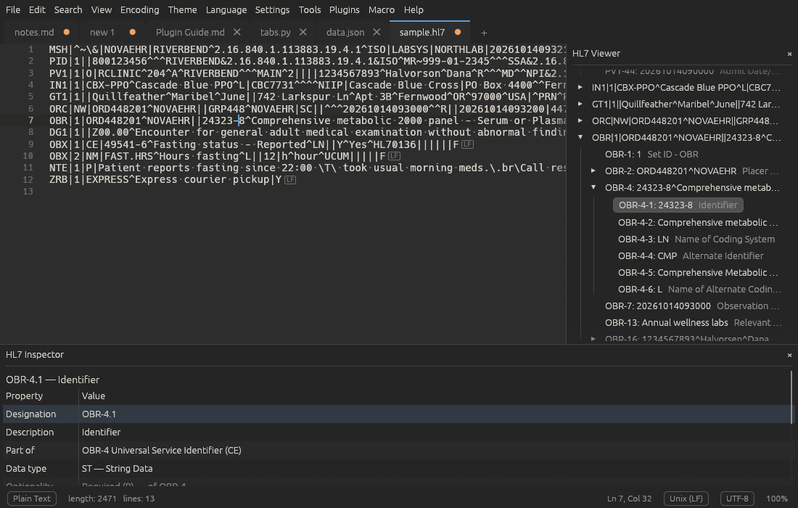

<p align="center">
  
</p>

<h1 align="center">Ettin Edit</h1>

<p align="center">
  <b>A text editor with two heads, because one opinion about tabs was never enough.</b><br>
  Fast, friendly and free of Notepad++ code. Runs on Linux and Windows.
</p>

<p align="center">
  <a href="https://github.com/Tharkis/Ettin-Edit/releases/latest"></a>
  
  <a href="LICENSE"></a>
  
  
</p>

<p align="center">
  <a href="#install">Install</a> ·
  <a href="#what-it-does">Features</a> ·
  <a href="#plugins">Plugins</a> ·
  <a href="#building">Build</a> ·
  <a href="FEATURES.md">Full feature list</a>
</p>

---

## Meet the heads

In Norse myth an *ettin* is a giant, and the famous ones had more than one head.
Ours has two, and they share one body, one tunic and, sadly, one breakfast bowl.

- **Edda** (left, helmet) keeps your tabs in order, your indentation straight and
  your JSON sorted. She has never once lost an unsaved file and would like you to
  know it.
- **Ottar** (right, glasses) writes everything down, compares everything with
  everything else and keeps asking for one more plugin.

They argue a lot. You get an editor that does both.



## What it does

Ettin Edit is a clean-room editor inspired by Notepad++. It looks the same on every
platform because it draws its own window with [egui](https://github.com/emilk/egui),
and it carries built-in versions of the Notepad++ plugins people install first.

| | |
| --- | --- |
| ✍️ **A proper editor** | Tabs, split view, multiple carets, column editing (with a Column Mode), code folding that follows the grammar, keyword completion, parameter hints, macros, bookmarks, auto-close and smart indent. Opens a 50 MB file in about a second. |
| 🎨 **Looks good in the dark** | Nine themes (Ettin Dark is the default), every one an editable file, plus a colour editor with live preview. Drop in any `.tmTheme` you like. |
| 🔎 **Finds things** | Find and replace with regex or extended escapes (`\n`, `\r\n`, `\t`, `\x41`), Find All in open tabs, Find in Files in the background, marks and a results panel. |
| 🧰 **Tools menu** | JSON and JavaScript formatting, minifying and a live JSON tree (JSTool). Base64, URL, HTML entities and SAML (MIME tools). XPath, pretty print, XSD/DTD validation and XSLT (XML Tools). |
| ⚖️ **Compare** | Two tabs, the last save, the clipboard or your last Git commit, with word-level highlights and moved blocks (our take on ComparePlus). |
| 📊 **CsvQuery** | Run SQL against the CSV you have open, join it with other open tabs and sort the results. Your spreadsheet would like a word. |
| 🌍 **Text in any shape** | About 80 languages, plus your own with a short `.lang.json` file. UTF-8, UTF-16 and legacy code pages, every line ending, Chinese, Japanese and Korean text. |
| 🧩 **Plugins in Python or JavaScript** | Your choice. Add commands, shortcuts, toolbar buttons and panels (even live Markdown, as the Markdown Preview sample does), and install them from Plugins > Manage Plugins. |
| 🧭 **Panels** | Function list, document map, a folder workspace, a character panel with every Unicode name, a hex view that edits bytes, and a command palette on F1. F11 hides everything except your words. |
| 🛟 **Doesn't lose your work** | Sessions and backups of unsaved changes come back after a crash, a reboot or a cat on the keyboard. |
| 🎛️ **A toolbar you arrange** | Office-style tabs of buttons for the commands you use most. Drag any menu command, macro or plugin command onto it, pick icons and labels, or collapse it out of the way. Hide the toolbar, the menu bar or both for a cleaner window (tap Alt to reach the menus). |
| ⌨️ **Yours to bend** | Preferences, fonts, and a Shortcut Mapper that rebinds any command. |
| 🗣️ **Speaks your language** | English, plus Deutsch, Français and Español (machine-translated for now, corrections welcome), following your system's language. Add your own with one text file. |

Everything that works today, and the few things that don't yet, is ticked off in
[FEATURES.md](FEATURES.md).

## User manual

The [Ettin Edit User Manual](https://tharkis.github.io/Ettin-Edit/) explains every
part of the editor and how to make it your own. It's also built into the app, so it
works offline: Help > User Manual, or <kbd>Shift</kbd>+<kbd>F1</kbd>.

## Install

Grab the latest build from the
[releases page](https://github.com/Tharkis/Ettin-Edit/releases/latest):

| You're on | Get this | Then |
| --- | --- | --- |
| **Windows** | `setup.exe` (no admin rights needed), or the `.zip` | Run it |
| **Arch / CachyOS** | `.pkg.tar.zst` | `sudo pacman -U ./ettin-edit-*.pkg.tar.zst` |
| **Debian / Ubuntu** | `.deb` | `sudo apt install ./ettin-edit_*_amd64.deb` |
| **Any other Linux** | `.tar.gz` | Extract it and run `./ettin-edit` |

Help > Check for Updates tells you when a newer one is out. On Debian and Ubuntu the
`.deb` also adds the Ettin Edit package repository, so your software updater installs
new versions for you ([details](https://tharkis.github.io/Ettin-Edit/installing.html#getting-updates-on-debian-and-ubuntu)).

To build the Arch package yourself from a checkout:

```sh
cd packaging/arch
makepkg -si
```

## Plugins

Write a plugin in whichever language you already know. This one adds a command that
shouts the selection back at you:

```python
import ettin

@ettin.command("Shout", shortcut="Ctrl+Alt+H", icon="megaphone")
def shout():
    doc = ettin.active()
    doc.replace_selections(doc.selected_text().upper())

ettin.run()
```

Plugins can read and change text, open and save files, react to events and show
panels with trees, tables and forms. Their commands can go on the toolbar, with the
icon you give them. Plugins > Install Sample Plugins gives you
three to poke at, including the HL7 Viewer, and the
[plugin guide](https://tharkis.github.io/Ettin-Edit/plugin-guide.html) covers the rest.

## Themes

Ettin Edit ships with nine themes. Ettin Dark, the default, is based on Base16 Eighties;
Ettin Night and Ettin Light are its own; the rest are classic schemes bundled with syntect.
All of them live as TextMate `.tmTheme` files in the themes folder, so you can change
any colour and pick **Theme > Reload Themes** to see it, or use
**Theme > Edit Theme Colours** for a live preview. Any other `.tmTheme` file you
put there appears under **Theme > Custom**. **Theme > Restore Built-in Themes** puts the
originals back and keeps your edited copy as `<name>.tmTheme.bak`.

- Linux: `~/.config/EttinEdit/themes/`
- Windows: `%APPDATA%\EttinEdit\themes\`

A built-in theme you haven't edited is updated when Ettin Edit is; one you have edited is
left alone.

## Building

Install Rust (https://rustup.rs), then:

```sh
cargo run --release -- path/to/file.txt   # run
cargo build --release                     # binary in target/release/
cargo test                                # unit tests
```

**Linux** needs the usual desktop libraries at run time (OpenGL, `libxkbcommon-x11` on X11).
On Debian/Ubuntu: `sudo apt install libxkbcommon-x11-0 libgl1`.

**Windows** builds with the normal MSVC toolchain (`cargo build --release`), or can be
cross-compiled from Linux with `rustup target add x86_64-pc-windows-gnu` and the MinGW linker
(`cargo build --release --target x86_64-pc-windows-gnu`).

## FAQ

**Is this Notepad++?** No. It's inspired by Notepad++ and shares none of its code.
Every line was written from scratch for Ettin Edit.

**Why two heads?** One to write the code and one to review it. Also because the
name was free.

**Does it run on Windows?** Yes, and on Linux, from the same code. Edda prefers
Linux. Ottar won't say.

**Can I use it at work, fork it or ship it?** Yes. Ettin Edit is MIT licensed, so
you can use, change and share it freely as long as you keep the copyright notice.
See [LICENSE](LICENSE). The toolbar icons are [Phosphor](https://phosphoricons.com/)
(MIT licence, © Phosphor Icons).

**Who gets the spoon?** Still being decided. Please don't open an issue about it.

<details>
<summary><b>Where things live in the code</b></summary>

| File | What it does |
| --- | --- |
| `src/main.rs` | Entry point: window setup, files from the command line |
| `src/app.rs` | The window: menus, tabs, editor, status bar, dialogs |
| `src/actions.rs` | Every command and its keyboard shortcut. Menus, shortcuts and plugins go through this list |
| `src/document.rs` | Loading, saving and reloading files: encodings, line endings, changes on disk |
| `src/encoding.rs` | Encoding detection, decoding and encoding (UTF-8, UTF-16, legacy code pages) |
| `src/session.rs` | The session and backups of unsaved changes |
| `src/instance.rs` | Single-window mode: hands files to the Ettin Edit already running |
| `src/system.rs` | Opening the file manager and a terminal, and reading the last Git commit |
| `src/file_ui.rs` | Rename, move to trash and summary dialogs, the changed-on-disk bar, the Encoding menu |
| `src/editor/` | The editor engine: `buffer.rs` (rope text and undo), `invisible.rs` (labels for invisible characters), `selection.rs` (carets), `layout.rs` (columns, word wrap, row index), `highlight.rs` (incremental highlighting), `find.rs` (find, replace, marks, bookmarks), `lines.rs` (line operations, case, comments), `smart.rs` (auto-close, smart indent, completion, brace matching, column editing), `fold.rs` (code folding), `fold_scan.rs` (grammar-aware fold regions, scanned in the background), `hints.rs` (parameter hints), `view.rs` (drawing, keyboard and mouse) |
| `src/search.rs` | Search queries (plain, extended escapes, whole word, regex), replacement templates, and Find in Files |
| `src/search_ui.rs` | The find bar, results panel, and the Go to Line and Find in Files dialogs |
| `src/tools_ui.rs` | The Column Editor and macro dialogs |
| `src/tools/` | The Tools menu's text tools: `mime.rs` (Base64, URL, quoted-printable, HTML, SAML), `json.rs` (JSON parser, formatter and tree), `js.rs` (JavaScript formatter and minifier), `xml.rs` (pretty print, linearize, syntax check, XPath at the caret), `xpath.rs` (XPath 1.0), `csv.rs` (reading delimited text), `sql.rs` (CsvQuery's SQLite tables and queries) |
| `src/csv_query.rs`, `src/app/csv_query.rs` | The CsvQuery panel, its background query thread, and which tabs are tables |
| `src/text_tools_ui.rs` | The JSON tree and XPath panels, and the notices tools show |
| `src/menu.rs`, `src/app/menus.rs` | Menus as data, so the Edit and Tools menus are drawn in both the menu bar and the right-click menu |
| `src/app/text_tools.rs` | Runs the text tools on the current document |
| `src/app/views.rs` | Split view: which tabs are in which view, moving and cloning tabs, the divider |
| `src/compare.rs` | The compare engine: line alignment, options, moved lines, word changes, unified patches |
| `src/compare_ui.rs`, `src/app/compare.rs` | The Compare tab, and starting and refreshing comparisons |
| `src/plugins/` | The plugin host: `mod.rs` (starting plugins, messages, commands, events), `manifest.rs` (`plugin.json`, finding plugins, the permission fingerprint), `process.rs` (plugin processes), `shortcut.rs` (shortcut text), `panel.rs` (JSON panels), `ui.rs` (Manage Plugins, the log and the permission prompt) |
| `src/app/plugins.rs` | Answers plugin calls on the open documents, sends events, draws plugin panels |
| `plugins/sdk/` | The Python and JavaScript SDKs that plugins import |
| `plugins/samples/` | The sample plugins: Text Statistics (Python), Markdown Outline (JavaScript), Markdown Preview (Python) and HL7 Viewer (Python; `hl7.py` parses messages, `hl7_defs.py` is the HL7 v2.5.1 dictionary) |
| `src/macros.rs` | Macro recording and playback steps |
| `src/prefs_ui.rs`, `src/shortcut_ui.rs`, `src/style_ui.rs` | Preferences, the Shortcut Mapper and the theme colour editor |
| `src/palette_ui.rs`, `src/app/commands.rs` | The command palette and tab list, and the list of every command |
| `src/folder_ui.rs`, `src/function_list_ui.rs`, `src/editor/map.rs`, `src/app/panels.rs` | The folder panel, function list and document map |
| `src/function_list.rs` | Finding functions, classes and headings in about 40 languages |
| `src/user_lang.rs`, `src/app/languages.rs`, `assets/syntaxes/` | User-defined languages (`.lang.json` to a grammar) and the extra built-in grammars |
| `src/lang_api.rs`, `assets/api/` | Keyword and function lists for completion and parameter hints, and the user's own lists in the `api` folder |
| `src/tools/xsd.rs`, `src/tools/dtd.rs`, `src/tools/xslt.rs`, `src/app/xml_schema.rs` | XSD and DTD validation and XSLT 1.0 |
| `src/print.rs`, `src/app/printing.rs` | Printing and HTML export |
| `src/hex.rs`, `src/hex_ui.rs` | Hex View: a tab's bytes as saved, and turning byte edits back into text |
| `src/char_panel.rs` | The Character Panel: Unicode blocks, names, HTML entities and search |
| `src/update.rs` | Checking GitHub for a newer release |
| `src/plugins/store.rs` | The plugin manager: the plugin index, downloads and safe installs |
| `docs/manual/`, `src/manual.rs` | The user manual (mdBook sources, also built into the app) and its in-app viewer; see `docs/manual/README.md` |
| `src/highlight.rs` | Language list and detection (syntect grammars) |
| `src/fonts.rs` | The editor font, installed fonts, and fallback fonts for Chinese, Japanese and Korean text |
| `src/theme.rs` | Built-in and custom themes: copying the built-ins to the themes folder, loading them, and the window colours derived from them |
| `src/settings.rs` | Settings, recent files and session, saved as JSON |
| `assets/themes/` | The nine built-in themes as `.tmTheme` files |
| `assets/icons/` | The app icon (SVG, PNG, ICO) |
| `packaging/` | Linux `.desktop` file and AppStream metadata, the Arch `PKGBUILD`, the `.deb` and APT repository scripts, and the Windows installer script (Inno Setup) |

The GUI uses [egui](https://github.com/emilk/egui)/eframe, which draws everything itself
with OpenGL, so the look is identical on Linux and Windows.

</details>

---

<p align="center"><sub>Mascot drawn for Ettin Edit. Edda and Ottar are not available for parties.</sub></p>
