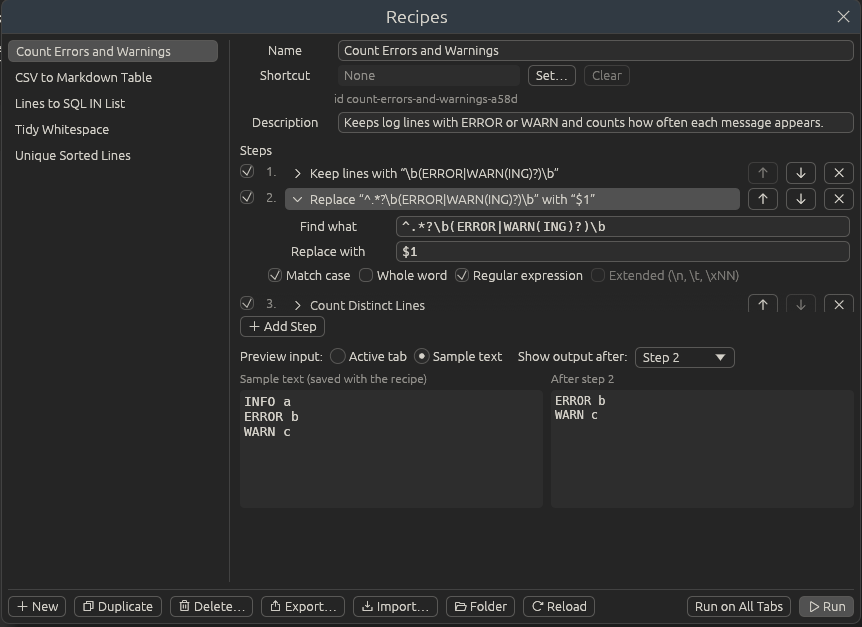

# Recipes

A recipe is a list of [Transform](transform.md) steps saved under a name:
find and replace, keep lines, sort, trim, convert to JSON, Base64, a shell
command and so on. Run it and every step happens in order, as one undo step.
Build it once, then use it on any file whenever the same clean-up comes round
again.

Recipes live in **Transform > Recipes** (also in the right-click menu), in
the **Recipes** group on the [toolbar](toolbar.md)'s Home and Transform tabs,
and in the [command palette](view.md#command-palette).

## Running a recipe

Pick it from **Transform > Recipes**. Like every Transform command it works on
the selection (each one, if there are several) or on the whole document when
nothing is selected. If a step fails, for example a JSON step on text that
isn't JSON, a message names the step and why, and the text is left as it was.

**Transform > Recipes > Run on All Open Tabs** runs a recipe on the whole text
of every open tab instead. Each tab changes as its own undo step; read-only
tabs and tabs shown in Hex View are skipped.

A recipe can have a [keyboard shortcut](shortcuts.md) of its own: set it in
the Recipes window (below), or find the recipe under **Transform › Recipes**
in the Shortcut Mapper. Recipes are also in the
[command palette](view.md#command-palette), shown as *Recipe · 3 steps*.

Each recipe has an **id**, like `clean-api-dump-7f3a`, made from its name the
first time it is saved. Shortcuts and toolbar buttons use the id, so renaming
a recipe keeps its shortcut and its toolbar button. (Shortcuts and buttons
made before 2.0.2 used the name; Ettin Edit moves them to the id the first
time it starts.)

## The Recipes window

**Transform > Recipes > Manage Recipes…** (<kbd>Ctrl+Alt+R</kbd>) opens the
Recipes window. Your recipes are listed on the left; pick one to see and change
its steps on the right. Double-click a recipe to run it.

- **Name** and **Description**: the name is what the menus show; the
  description shows when you point at the recipe in the list.
- **Shortcut**: click **Set…** and press the keys you want; **Clear** takes
  the shortcut away. If another command already has those keys, the window
  says which and offers **Move It Here**, as the Shortcut Mapper does. The
  recipe's id is shown under the shortcut.
- **Steps**: click a step to open its settings. The tick box switches a step
  off without removing it, the arrows move it, and the cross removes it.
- **Add Step** lists every step, by group (below). Type in the search box at
  its top to list every step whose name has those words, from all groups;
  the arrow keys move the highlight and <kbd>Enter</kbd> adds it.
- **Preview input** picks the text the preview runs on: the **Active tab**
  (the selection, or the document) or **Sample text** you type or paste
  into the left pane. The sample is saved with the recipe (as `"sample"` in
  its file), so it travels with an export and is there next time.
- **Show output after** picks the step whose result the right pane shows:
  **The last step**, or any step before it. Clicking a step picks it too, so
  you can walk through a recipe one step at a time. If a step fails, its
  message shows under that step and in the right pane.
- The preview updates as you change any step. It uses the first 20,000
  characters, and stops before a step that runs a shell command.

<p></p>

Every change is saved straight away. The buttons along the bottom make a
**New** recipe, **Duplicate**, **Delete**, **Export…** or **Import…** one,
open the recipes **Folder**, and **Reload** it after you've changed files
there yourself. **Run** and **Run on All Tabs** on the right run the recipe
you're looking at. (If a translation makes the labels too long to fit, the
buttons show only their icons; point at one to see what it does.)

**Transform > Recipes > Run Last Recipe** (also on the toolbar's Home tab)
runs the recipe you ran last again on the active tab; its tooltip names it.

## Recording a recipe

You can also make a recipe by doing the job once:

1. Choose **Transform > Recipes > Record Recipe**. The status bar shows
   **● Recording recipe** and how many steps it has so far.
2. Run the commands you want, from the menus, the toolbar or their shortcuts.
3. Choose **Transform > Recipes > Stop Recording Recipe**, or click the status
   bar message.

The Recipes window opens with the new recipe, ready for a name. Commands that
change text become steps: everything in the Transform menu (including the
same commands in Edit > Line Operations and on the toolbar). **Replace All** in the
find bar becomes a find-and-replace step with the find bar's text and options.
Typing, moving the caret and other commands aren't recorded; use a
[macro](macros.md) for those. A macro made only of transforms can become a
recipe too: see [Turning a macro into a recipe](macros.md#turning-a-macro-into-a-recipe).

Recipes replay transforms and can run from the command line; macros replay
keystrokes and edits. The top of each submenu in **Transform** says so.

## The steps

**Add Step** offers the same groups, in the same order, as the
[Transform menu](transform.md#the-transform-menu):

| Group | Steps |
| --- | --- |
| Find and Replace | Replace every match, with **Match case**, **Whole word**, **Regular expression** or **Extended** (`\n`, `\t`, `\xNN`), exactly as in the [find bar](search.md). `$1` or `\1` put a group back |
| Lines | Keep or Remove Matching Lines, Count Distinct Lines, Sort (lexically, ignoring case, as integers, as decimals or by length; ascending or descending), Reverse Line Order, Remove Duplicate Lines (all, or only repeats next to each other), Remove Empty Lines (and blank ones), Trim, Join Lines, Add Prefix and Suffix, Number Lines, Reflow Paragraphs, Tabs to Spaces, Spaces to Tabs |
| Convert Case To | UPPERCASE, lowercase, Title Case, Sentence case, iNVERT cASE, camelCase, PascalCase, snake_case, kebab-case, CONSTANT_CASE |
| Convert to | JSON, YAML, TOML, XML, CSV or a Markdown table. **Read as** is **Auto** (the format the text looks like when the step runs) or a format you pick. Recipes from 2.0.0 with a "from X to Y" step still run as before |
| Encode and Hash | Every [MIME Tools](mime.md) encoding and decoding, MD5, SHA-1, SHA-256, SHA-512, CRC32, Text to Hex, Hex to Text, Decode JWT |
| JSON and XML | JSON Format, Minify and Sort Keys; Format XML (with or without attributes on their own lines), Linearize, Escape and Unescape |
| Command | Filter Through Command: any shell command, as in [Transform](transform.md#filter-through-a-command) |

A few steps behave a little differently inside a recipe, because a recipe
always turns text into text:

- **Count Distinct Lines** replaces the text with the counts instead of
  opening a new tab.
- A **hash** replaces the text with the hash, even when nothing is selected.
- Case steps convert all the text, not just the word at the caret.
- Line steps work on the text exactly as selected (the menu commands take
  every line a selection touches).

## Recipes that run commands

A Command step runs a program on your computer, so a recipe with one always
asks before it runs and lists the commands. Tick **Don't ask again for this
recipe until its commands change** to skip the question next time; if anyone
changes a command or the recipe's name, it asks again. A recipe with commands
has a terminal sign after its name in the Recipes window.

While a recipe takes more than a moment, a message shows it with a **Stop**
button. Stopping leaves the text as it was.

[Macros](macros.md) never replay shell commands; recipes do, because they ask
first.

## The recipe files

Each recipe is a JSON file in the `recipes` folder of the
[settings folder](folders.md#the-settings-folder), so you can copy, share,
back up or edit recipes like any other file. **Transform > Recipes > Open
Recipes Folder** opens it. Ettin Edit puts five sample recipes there the first
time it starts: Tidy Whitespace, Unique Sorted Lines, Count Errors and
Warnings, Lines to SQL IN List and CSV to Markdown Table. Change or delete them
as you like; they don't come back.

A recipe file looks like this:

```json
{
  "version": 1,
  "name": "Lines to SQL IN List",
  "id": "lines-to-sql-in-list-0c4e",
  "description": "Turns one value per line into IN ('a', 'b', 'c').",
  "steps": [
    { "op": "trim", "kind": "Both" },
    { "op": "remove_empty_lines", "blank": true },
    { "op": "replace", "find": "'", "replace": "''", "regex": true },
    { "op": "affix_lines", "prefix": "'", "suffix": "'," },
    { "op": "join_lines" },
    { "op": "replace", "find": ",[ \\t]*$", "replace": "", "regex": true },
    { "op": "affix_lines", "prefix": "IN (", "suffix": ")" }
  ]
}
```

Each step has an `op` and its settings; settings you leave out take their
defaults, and `"enabled": false` switches a step off. An optional `"sample"`
holds the recipe window's sample text. A file without an `id`
gets one when Ettin Edit reads it (and it is written back), and so does a
copied file whose id another recipe already has. A Convert to step looks like
`{ "op": "convert_to", "to": "Yaml" }`, with `"from": "Json"` when it reads
the text as a set format. The easiest way to learn
the names is to build a recipe in the window and open its file. To share one,
use **Export Recipe…**, or send the file; the other person uses **Import
Recipes…** or drops it into their recipes folder.

## From the command line

Recipes also run without opening a window, for scripts and batch jobs:

```
ettin-edit --recipe "Tidy Whitespace" < in.txt > out.txt
ettin-edit --recipe "Tidy Whitespace" notes.txt todo.txt > tidy.txt
ettin-edit --recipe "Tidy Whitespace" --in-place *.txt
ettin-edit --recipe my-recipe.json data.csv
ettin-edit --list-recipes
```

- `--recipe` takes a recipe's name (from your recipes folder, ignoring case),
  its id, or the path of a recipe file.
- With no files it reads standard input. Files are written one after another
  to standard output, or changed where they are with `--in-place` (files the
  recipe doesn't change are left untouched).
- A recipe with Command steps only runs with `--allow-commands`; without it,
  Ettin Edit lists the commands and stops.
- Files must be UTF-8; a byte-order mark and Windows line endings are kept.
- If a step fails, the message goes to standard error and the exit code is 1
  (2 for a mistake in the options).

On Windows, run it from PowerShell or a script, which wait for it to finish.

## Recipes in plugins

Plugins can run a recipe with
`run_action({"RunRecipe": "Tidy Whitespace"})` (or `RunRecipeOnAllTabs`); see
[Writing plugins](plugin-guide.md#messages-input-and-more).
