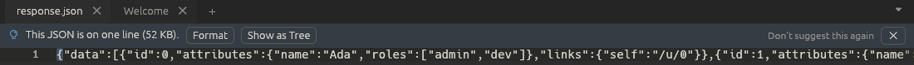

# Suggestions

When you open a file, or paste more than 1 KB of text, Ettin Edit looks at
the start of it (the first 64 KB) and, if a transform would obviously help,
says so in a thin bar above the text:

| When the text is… | The bar offers |
| --- | --- |
| JSON with almost everything on one line (more than 500 characters) | **Format** and **Show as Tree** ([JSON tools](json.md)) |
| XML with almost everything on one line | **Format** ([XML Tools](xml.md)) |
| A JSON Web Token (three Base64 parts; the first a header with `alg`) | **Decode** ([Hex and JWT](transform.md#hex-and-jwt)) |
| A block of Base64 that decodes to readable text | **Decode** ([MIME Tools](mime.md)) |
| Comma, tab or semicolon separated values, or a `.csv` file | **Open in CsvQuery** ([CsvQuery](csvquery.md)) and **Show as Table** ([Tables](tables.md)) |
| A file with more than one kind of line break | **Fix**: use LF or CRLF everywhere |
| A file indented with both tabs and spaces | **Fix**: tabs to spaces, or spaces to tabs |

A tab shows at most one suggestion. It goes away when you use a button,
close it with **×**, or edit the text, and nothing happens unless you press a
button. Ettin Edit is careful not to guess: prose, Markdown tables and short
words that happen to be valid Base64 don't get a bar.

**Don't suggest this again** turns that kind of suggestion off for good.
**Settings > Preferences > Files and Startup** turns all suggestions off, and
**Show the dismissed suggestions again** brings back the ones you turned off.
