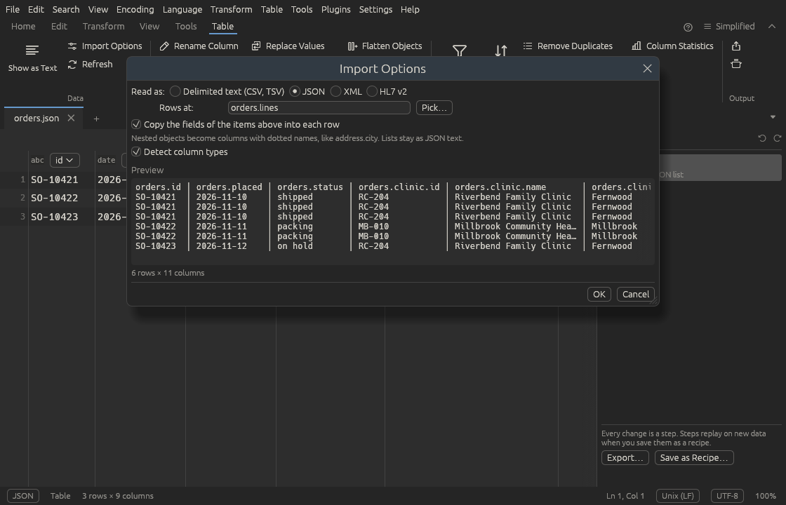
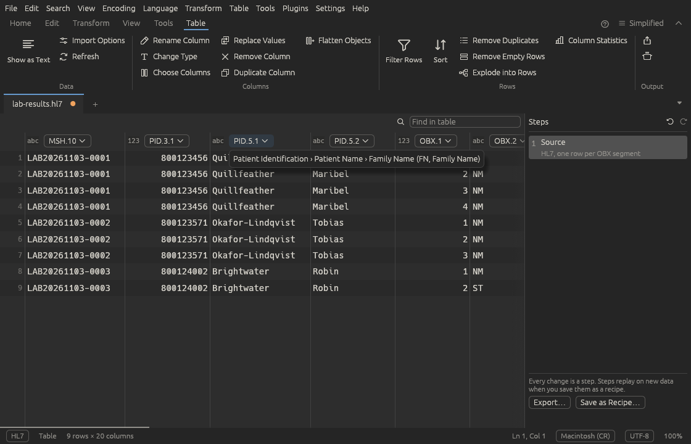
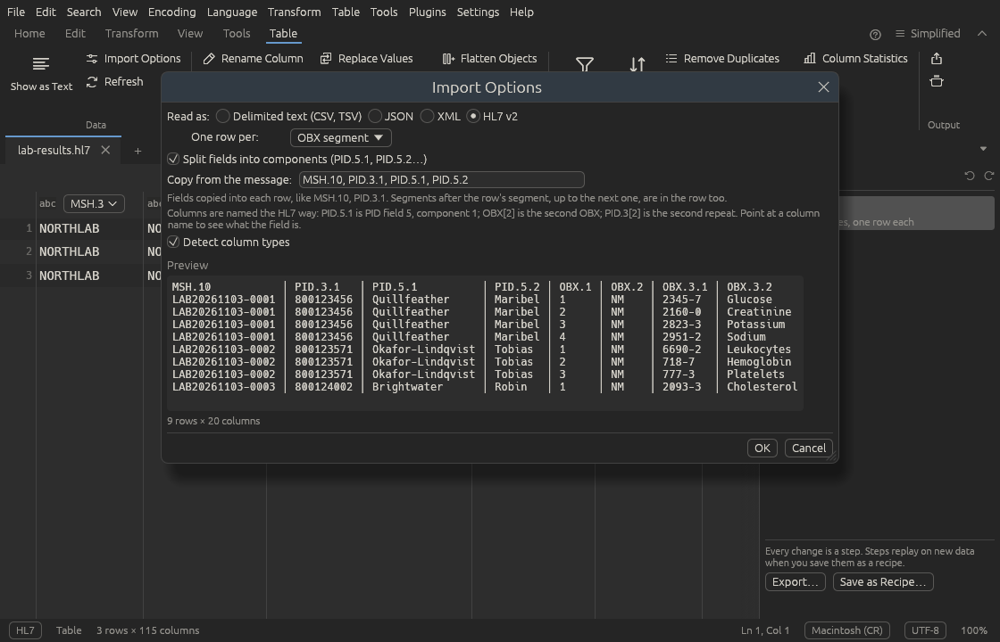
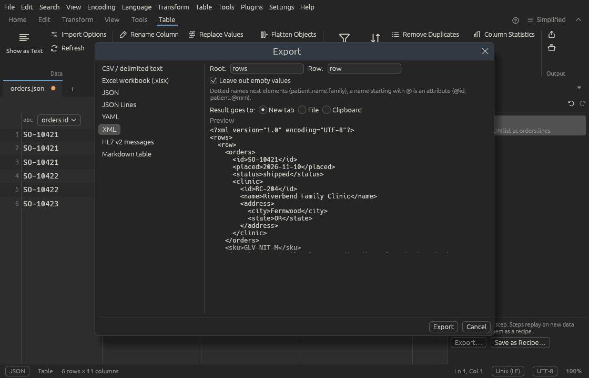

# Tables

A table tab shows data as rows and columns, like a spreadsheet, so you can
reshape an export from one system into what another system wants: pick and
rename columns, read dates the way they were written, filter and sort rows,
and write the result as CSV, an Excel workbook, JSON, YAML, XML, HL7 v2
messages or Markdown.

Every change you make is a **step**. The steps are kept in order on the
right, can be switched off, changed or removed at any time, and can be saved
as a [recipe](recipes.md) that does the same to next week's export, in the
app or from the command line.

<p></p>

## Opening data as a table

- **Excel and OpenDocument workbooks** (`.xlsx`, `.xlsm`, `.xls`, `.xlsb`,
  `.ods`) open straight into a table tab, from **File > Open…**, the
  command line or by dropping them on the window. The workbook itself is
  never changed; use **Export** to write the result.
- **CSV, TSV, JSON, XML and HL7 v2**: open the file as usual and press
  <kbd>Ctrl+Alt+T</kbd> (**Table > Show as Table**), or use **File > Open as
  Table…** to do both at once. When a file looks like CSV, the
  [suggestion bar](suggestions.md) offers **Show as Table** too.
- Any text tab can be shown as a table. <kbd>Ctrl+Alt+T</kbd> again (or
  **Show as Text**) goes back to the text; the table and its steps stay, and
  follow the text when you edit it.

Ettin Edit guesses how to read the data: the delimiter and whether the
first row holds the column names for delimited text, the header row for a
workbook, the list of rows for JSON and XML, and one row per message for
HL7. The **Source** step at the top of
the Steps panel says what it chose; click it (or **Table > Import
Options…**) to change it, with a live preview:

| Data | Options |
| --- | --- |
| Delimited text | Delimiter (comma, tab, semicolon, pipe or any other character), quote character or none, first row has the column names |
| Workbook | Sheet, and the row with the column names (rows above it, such as a report title, are skipped; 0 means there are no names) |
| JSON | Where the rows are, like `data.items` (empty to let Ettin Edit find them). **Pick…** lists every list in the file. Nested objects become columns with dotted names such as `address.city`; lists stay as JSON text |
| XML | Which elements are the rows, like `appointment` or `order.line` (empty to find them). Attributes and child elements become columns |
| HL7 v2 | One row per message or per segment, whether fields are split into components, and which fields to copy into each row |

Ettin Edit comes with made-up sample files to try all this on, in the
[`samples/tables`](https://github.com/Tharkis/Ettin-Edit/tree/main/samples/tables)
folder of the source: lab results in HL7, orders in JSON, appointments in
XML and patients in CSV. Every name and number in them is invented.
**Detect column types** is on by default.

## Nested data

JSON and XML exports are trees: an order holds a clinic and a list of order
lines, an appointment holds a patient with a name. A table needs rows, so
you say which items are the rows, and the rest becomes columns:

<p></p>

- **Rows at** is a path of names separated by dots. When a path goes
  through a list, every item of it is followed, so `orders.lines` gives one
  row per order line across all the orders.
- **Copy the fields of the items above into each row** (on by default) puts
  the order's own fields into each of its lines, named with the path, such
  as `orders.id` and `orders.clinic.name`. Untick it for just the lines.
- Objects inside a row become dotted columns (`clinic.address.city`). Lists
  inside a row stay as JSON text, ready for **Explode into Rows**.

For XML, an element's attributes and child elements both become columns.
An attribute keeps its plain name (`id`), or becomes `@id` when a child
element has the same name. An element with only text, like
`<provider npi="1234567893">Dana Halvorsen, MD</provider>`, gives a `provider`
column for the text and `provider.npi` for the attribute. An element that
appears more than once in a row, like several `<reason>` elements, becomes
a list.

### Explode into Rows and Flatten Objects

Two steps, in the column menu and the **Table** menu, finish the job:

- **Explode into Rows** gives each item of a column its own row, with the
  other columns repeated. Leave **Split at** empty for a JSON list, or type
  a separator such as `;`, `|` or `\n` (a line break) for a list written as
  text. An empty cell keeps its row.
- **Flatten Objects** turns a column of JSON objects into a column per
  field: `reason.code` and `reason.text` for a column `reason`. Use it after
  exploding a list of objects. Cells that aren't objects stay in the column.

## HL7 v2 messages

HL7 v2 files (`.hl7`, or any text whose lines start with `MSH|`) are read
by Ettin Edit itself; the HL7 viewer plugin isn't needed. Each message
becomes a row, and each field a column named the way HL7 people write it:

| Column | Means |
| --- | --- |
| `PID.5` | PID segment, field 5 |
| `PID.5.1` | PID field 5, component 1 (with **Split fields into components**) |
| `PID.3.4.1` | a subcomponent |
| `PID.3[2]` | the second repeat of PID field 3 |
| `OBX[2].5` | field 5 of the second OBX segment in the message |

Point at a column's name to see what it is, such as *Patient Identification ›
Patient Name › Family Name*. Escape sequences such as `\F\` and `\.br\` are
turned back into the characters they stand for.

<p></p>

<p></p>

Lab results are easier to work with as one row per result. In **Import
Options**, set **One row per** to a segment, such as **OBX segment**:

- Each row holds that segment's fields, plus the segments after it up to the
  next one, so a note (`NTE`) that follows a result is in the result's row.
- **Copy from the message** lists the fields put into every row, such as
  `MSH.10` (the message's control id), `PID.3.1` and `PID.5.1`. Change it to
  any fields you like, separated by commas.

## Column types

Each column has a type, shown as a small badge in its header:

| Badge | Type | Values look like |
| --- | --- | --- |
| `abc` | Text | anything |
| `123` | Whole number | `42`, `-7` |
| `1.2` | Decimal | `3.25` |
| `date` | Date | `2026-11-03` |
| `time` | Date and time | `2026-11-03 08:12:00` |
| `y/n` | True/false | `true`, `false` |

Detection is careful: a column of codes such as `000123` stays text, so the
leading zeros survive. A value that doesn't fit its column's type is kept as
it is and drawn in red, and the status bar counts them, so a stray `n/a` in
a column of weights is easy to find.

**Change Type…** (in a column's menu, or **Table > Columns**) sets a
column's type. For dates written another way, give a **date pattern**:

<p></p>

| Token | Means |
| --- | --- |
| `YYYY` / `YY` | year, four or two digits (`YY` 00–49 is 20xx, 50–99 is 19xx) |
| `MM` / `M` | month number |
| `MMM` / `MMMM` | month name, short or long (`Nov`, `November`) |
| `DD` / `D` | day of the month |
| `HH` / `H` | hour, 0–23 |
| `hh` / `h` | hour, 1–12, with `A` |
| `mm` | minutes |
| `ss` | seconds |
| `SSS` | fractions of a second (read and dropped) |
| `A` | AM or PM |

Anything else must appear as written: `DD/MM/YYYY` reads `02/03/1984`,
`YYYYMMDD` reads `19840302`, `D MMM YYYY h:mm A` reads `3 Nov 2026 8:12 PM`.
Numbers can have fewer digits when a separator follows, so `D/M/YYYY`
reads `2/3/1984` too. Dates are stored as `YYYY-MM-DD` and date-times as
`YYYY-MM-DD HH:MM:SS`, so they sort properly and export cleanly.

For numbers, **Decimal comma** reads `1.234,5` as 1234.5. Thousands
separators are dropped either way.

## Changing the table

Click a column's name for its menu, or right-click it. The same commands are
in the **Table** menu, on the ribbon's **Table** tab (which appears while a
table is showing), in the [command palette](tour.md) and in the right-click
menu of a cell.

| Group | Commands |
| --- | --- |
| Columns | Rename, Change Type, Duplicate, Flatten Objects, Move Left and Right, Remove, Choose Columns (tick the ones to keep and drag them into order) |
| Values | Replace Values (in one column or all; whole cell, match case, regular expression), and Text: Trim spaces, Collapse spaces, UPPER CASE, lower case, Title Case |
| Rows | Sort Ascending, Sort Descending, Sort… (several columns), Filter Rows…, Explode into Rows, Remove Duplicates (rows that match on the columns you pick; the first is kept), Remove Empty Rows, Remove Row |

Most commands open a small dialog with a preview of the result before you
press **OK**. Empty cells always sort last.

**Filter Rows…** keeps the rows where a column *is*, *is not*, *contains*,
*starts with*, *is empty*, *is greater than* and so on, or *is one of* a
list of values you tick (with how often each appears). Right-click a cell
for **Keep only "North"** or **Hide "North"** in one click. Filters show as
chips above the grid; **×** on a chip removes that filter.

### Editing cells

Double-click a cell, or select it and press <kbd>Enter</kbd> or
<kbd>F2</kbd>, to type a new value; <kbd>Delete</kbd> clears it. A cell edit
is a step too, but it picks its row by number, so it is marked **by row
number**: on next week's data, row 12 may be someone else. Prefer **Replace
Values** or a filter in steps you want to replay.

### Finding

The **Find in table** box above the grid (<kbd>Ctrl+F</kbd>) highlights
matching cells; <kbd>Enter</kbd> jumps to the next one. **Column
Statistics** shows how many cells are filled, empty and distinct, how many
don't fit the type, the smallest and largest values and the most common
ones.

## The Steps panel

The first step, **Source**, reads the data; each step after it changes the
table. In the panel you can:

- **Click** a step to see the table as it was after that step. A banner
  says so; **Show the result** goes back to the end. A new step is added
  after the one you're looking at.
- **Untick** a step to switch it off and see the table without it.
- Move it up or down, change it (pencil, or double-click) or delete it.

Renaming a column renames it in the later steps too. If a step can't run any
more, for example because an earlier change removed its column, it says why
in red and the steps after it are skipped; the table shows what came before.

<kbd>Ctrl+Z</kbd> and <kbd>Ctrl+Y</kbd> undo and redo changes to the steps.

## Exporting

**Export** writes the table as (<kbd>Ctrl+S</kbd> opens it too, in a workbook
tab or a table tab with changes):

| Format | Options |
| --- | --- |
| CSV / delimited text | Delimiter, quote values when needed, always or never, write the column names, Windows line endings |
| Excel workbook (.xlsx) | Sheet name. Numbers, dates and true/false are written as real Excel values, with a bold header row and fitted column widths |
| JSON | A list of objects; indented or not, numbers and true/false as JSON values, empty cells as `null`. **Dotted names as nested objects** writes `clinic.city` as `"clinic": { "city": … }` |
| JSON Lines | One object per line, nested or not |
| YAML | A list of mappings, nested by dotted names (on by default) |
| XML | A root element (`rows`) holding one element per row (`row`). Dotted names nest elements (`patient.name.family`) and a name starting with `@` is an attribute (`@id`, `patient.@mrn`). Empty values are left out unless you untick it |
| HL7 v2 messages | One message per row, from a template (below) |
| Markdown table | |

The result goes to a **new tab**, a **file** or the **clipboard** (a
workbook can only go to a file). A preview shows the first rows. Saving never
writes over the workbook or file you opened: a table tab with changes asks
where to export instead, and closing it asks first, like any unsaved tab.

<p></p>

### Writing HL7 messages

An HL7 export fills a **template** once for each row. The template is the
message as it should be written, one segment per line, with `{Column}`
wherever a column's value goes:

```
MSH|^~\&|ETTIN|NORTHLAB|||{Sent}||ADT^A08|MSG{#}|P|2.5.1
PID|||{MRN}^^^NORTHLAB^MR||{Family}^{Given}||{Born}|{Sex}
```

- Values are escaped for HL7, so a `|` or `^` in a name can't break the
  message.
- `{#}` is the row number, handy for message control ids.
- `{{` and `}}` write a brace.
- A column the template names that the table doesn't have is an error,
  shown in the preview.

When the columns already have HL7 names, like the ones read from an HL7
file, the template is made for you from them, so changing a few values and
exporting writes the messages back. Otherwise it starts as a short `MSH`
and `PID` skeleton to fill in. Segments are separated by a carriage return,
as HL7 expects.

## Saving the steps as a recipe

**Save as Recipe…** saves how the data is read, every step and the export as
a recipe with one **Table** step. Run it on the next file from the
[Recipes window](recipes.md), or from the command line, where `--out`
writes the result to a file (needed for an Excel workbook):

```
ettin-edit --recipe "Ward report" export.csv > report.json
ettin-edit --recipe "Ward report" export.xlsx --out report.xlsx
```

A recipe made from a workbook reads workbooks, and one made from CSV reads
CSV: the Source step is part of the recipe.

To change a saved table recipe, open some data as a table, make the steps
again, and save under the same name: the recipe's steps are replaced.

Open tables and their steps are kept with the [session](files.md#you-wont-lose-your-work),
so they are still there after a restart.
