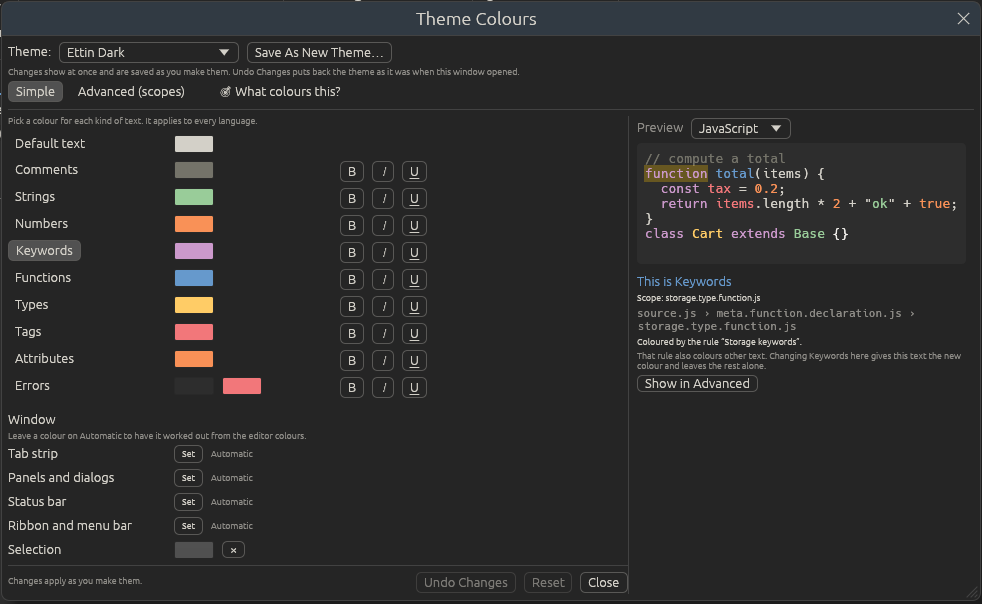

# Themes and colours

A theme colours both the text and the whole window: menus, tabs, panels and
the status bar. Ettin Edit comes with nine:

| Dark | Light |
| --- | --- |
| **Ettin Dark** (the default, based on Base16 Eighties) | **Ettin Light** |
| **Ettin Night** | **Ocean Light** |
| **Ocean Dark** | **Solarized Light** |
| **Mocha** | **GitHub Light** |
| **Solarized Dark** | |

Pick one from **View > Theme**, where they're listed under **Dark** and
**Light**. The change is immediate and remembered.

To have Ettin Edit switch between a light and a dark theme with your desktop,
turn on **Follow the system's light/dark setting** in
[Preferences > Appearance](preferences.md#appearance) and pick the pair.

## Themes are files

Every theme, built-in ones included, is a TextMate `.tmTheme` file in the
themes folder:

- Linux: `~/.config/EttinEdit/themes/`
- Windows: `%APPDATA%\EttinEdit\themes\`

**View > Theme > Open Themes Folder** opens it. This means you can:

- **Change a built-in theme** by editing its file. When you save it, Ettin
  Edit reloads it within a second. If the file has a mistake, the editor keeps
  the last version that worked and a message names the file and line, with an
  **Open** button. (**View > Theme > Reload Themes** reloads them all.)
- **Add a theme** by dropping any `.tmTheme` file into the folder. Themes you
  add appear under **Custom** in **View > Theme**.
  Thousands of `.tmTheme` files exist for TextMate, Sublime Text and other
  editors.
- **Share a theme** by sending someone the file.

When Ettin Edit is updated, built-in themes you haven't edited are updated
with it; ones you have edited are left alone. **View > Theme > Restore Built-in
Themes** puts the original built-in themes back and keeps each edited copy
as `<name>.tmTheme.bak`, so nothing is lost.

## Edit Theme Colours

**View > Theme > Edit Theme Colours…** changes a theme without touching its file by
hand. Every change shows in the editor at once and is saved to the theme's
file half a second after you stop, so you can see what you're doing and
there's nothing to remember to save.

- **Theme** at the top picks the theme to edit (and switches to it).
- **Simple** and **Advanced (scopes)** switch between the two views described
  below. A preview of a short sample (JavaScript, Python, Rust, HTML or JSON)
  sits on the right of both.
- **Undo Changes** puts the theme back exactly as it was when you opened the
  window. The window says how many settings you've changed since then.
- **Reset** puts a built-in theme back as Ettin Edit ships it. (Themes you
  added have no original to go back to, so only Undo Changes works for them.)
- **Save As New Theme…** saves your changes as a new theme with a name you
  choose and puts the original back as it was, so you can experiment on a
  built-in theme and keep the result separately.
- **Close** keeps the changes.

### Simple and Advanced

The **Simple** view has ten named colours: **Default text**, **Comments**,
**Strings**, **Numbers**, **Keywords**, **Functions**, **Types**, **Tags**,
**Attributes** and **Errors**. Each has a colour, **B**, **I** and **U** for
bold, italic and underline, and a background colour when the theme gives it
one (Errors usually have one). Hover over a name to see the scopes it stands for.

Changing one changes that kind of text in every language at once: Keywords
recolours `fn` and `if` in Rust, `def` and `return` in Python, `true` and
`null` in JSON, and so on. Behind the scenes Ettin Edit updates every rule
that colours only that kind of text and adds one rule, named after the colour,
for all of its scopes. Rules for special places keep their own colours, such
as the colour some themes give to JSON keys (which are strings too).

The **Advanced (scopes)** view is the theme as it is stored:

- **Editor** colours: the **Background**, **Text**, **Caret**, **Selection**,
  **Current line**, **Line numbers**, **Indent guides**, **Whitespace
  symbols**, **Search matches**, the **Accent** used for the current tab,
  buttons and fold markers, and the window colours below. Click a colour to
  change it, or **Don't set this colour** to fall back to the default.
- **Syntax** colours are a list of rules. Each rule has a name, a **Scope**
  that says which text it colours, a colour, and **B**, **I** and **U**. Type
  in **Find** to look for a rule, such as `string` or `comment`. **Add Rule**
  adds one, and the button at the end of a rule deletes it. Every rule of the
  built-in themes has a name.

### What colours this?

Not sure which colour a word uses? Click **🎯 What colours this?**, then click
the word, either in the preview or in the editor behind the window. The
window selects its Simple colour and tells you:

- its scope, and every scope around it (outermost first),
- the rule that colours it, and
- whether changing the Simple colour will change it. A word coloured by a
  rule for a special place (a JSON key, say) has to be changed in Advanced;
  **Show in Advanced** jumps to that rule and marks it with ▶.

### Window colours

The **Window** colours in the Simple view are the **Tab strip**, **Panels
and dialogs**, **Status bar**, **Ribbon and menu bar**, and **Selection**.
Leave one on **Automatic** to have it worked out from the editor colours, as
Ettin Edit always did; **Set** gives it a colour of its own. They're stored
with the theme's editor colours as `ettinTabStrip`, `ettinPanels`,
`ettinStatusBar` and `ettinRibbon` (selection is the usual `selection`), so
they travel with the theme file. Other editors that read `.tmTheme` files
ignore them, and themes without them work as before.

### Scopes

Languages label each piece of text with a *scope*, such as
`comment.line.double-slash.rust` or `string.quoted.double.json`. A rule's
scope colours every piece of text whose scope starts with it, so `string`
colours every kind of string in every language, and `string.quoted.double.json`
only colours double-quoted strings in JSON. The most specific rule wins.
Separate several scopes with commas.

The scopes most themes set are `comment`, `string`, `constant.numeric`,
`constant.language`, `keyword`, `storage`, `entity.name.function`,
`entity.name.type`, `variable`, `support.function` and `invalid`. See
[Languages](languages.md#keyword-groups) for the scopes your own languages
use.

## Fonts

The editor's font and size are in [Preferences](preferences.md), not in the
theme, so they stay the same whichever theme you pick.
