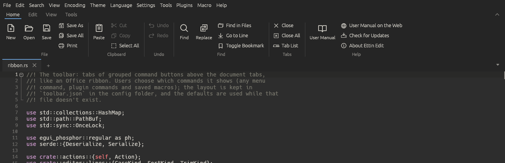
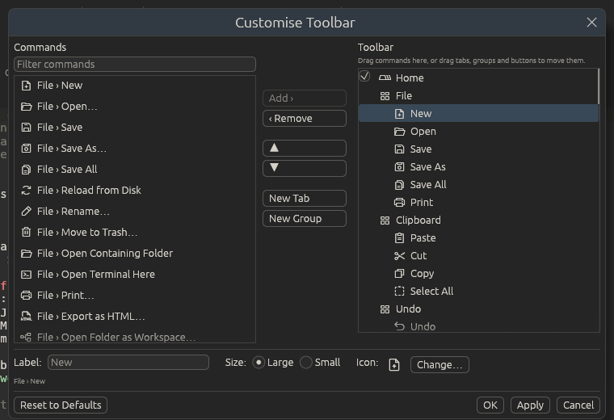

# The toolbar

Under the menu bar is a tabbed toolbar, like the ribbon in Microsoft Office.
Each tab holds groups of buttons for commands you use often. You can put any
menu command on it, plugin commands and saved macros too, and arrange the
tabs, groups and buttons however you like.

## Using it

- Click a tab name (**Home**, **Edit**, **View**, **Tools**) to show its buttons.
- Hover over a button to see where its command is in the menus and its
  shortcut.
- Buttons for commands that turn something on or off, such as **Word Wrap**,
  are outlined while it's on. Buttons for commands that can't run right now,
  such as **Undo** with nothing to undo, are greyed out.
- When the window is too narrow for a tab, scroll its buttons sideways with
  <kbd>Shift</kbd> and the mouse wheel.

### The default tabs

| Tab | Groups |
| --- | --- |
| **Home** | File, Clipboard, Undo, Find, Tabs |
| **Edit** | Lines, Sort, Case, Comment, Blanks, Selection |
| **View** | Show, Zoom, Folding, Panels, Window, Customise |
| **Tools** | Compare, JSON, XML, Data (CsvQuery and MIME Tools), Macros |

## Collapsing and hiding

To give the text more room, collapse the toolbar so only its tab names show:

- click **⌃** at the right end of the tab names, or
- double-click a tab name, or
- press <kbd>Ctrl+F1</kbd>, or
- choose **View > Collapse Toolbar**.

While it's collapsed, clicking a tab name opens its buttons over the text;
they close again when you click a button or anywhere else. Expand it the same
ways (**⌄** at the right end).

**View > Toolbar** hides the toolbar completely and shows it again; so does
**Hide the toolbar** in its right-click menu.

You can hide the classic menu bar as well, with **View > Menu Bar**,
<kbd>Ctrl+M</kbd> or **Hide the menu bar** in the toolbar's right-click menu.
While it's hidden, tap <kbd>Alt</kbd> to show it for a moment, and press
<kbd>Ctrl+M</kbd> to bring it back for good. With both hidden, only the tabs,
the text and the status bar are left. Both choices are kept in
`settings.json`.

## Customising

Open **Settings > Customise Toolbar…**, or right-click the toolbar and choose
**Customise Toolbar…** (it's also in **View** and in Preferences).

On the left is every command you can add: everything in the menus (themes,
languages and encodings included), the commands of plugins that are running,
and your saved macros. Type in the filter box to narrow the list; it matches
every word you type, anywhere in the command's menu path.

On the right is the toolbar: tabs, the groups in each tab, and the buttons in
each group.

### Adding a button

- **Drag** a command from the left onto the right. Dropped on a button, it
  goes in front of that button; dropped on a group or a tab, it goes at the
  end of it.
- Or pick a command on the left, select where it should go on the right, and
  click **Add ›** (or double-click the command). It goes after the selected
  button, or at the end of the selected group.

### Arranging

- **Drag** tabs, groups and buttons to move them. A button can move to another
  group or tab, and a group to another tab.
- **▲** and **▼** move the selected item one place. A button at the end of its
  group moves into the next group.
- **‹ Remove** takes the selected button, group or tab off the toolbar. You
  can also right-click a button on the toolbar and choose **Remove from
  Toolbar**.
- **New Tab** and **New Group** add an empty one after the selection.
- Untick the box in front of a tab to hide it without losing its buttons.

### Changing a button, group or tab

Select it on the right and change it at the bottom of the dialog:

| Selected | What you can change |
| --- | --- |
| A tab or group | Its name. The built-in names follow the interface language until you rename them. |
| A button | **Label** (leave it empty for the command's own name), **Size** and **Icon** |

**Large** buttons have the icon above the label. **Small** buttons have the
icon beside the label, and three of them stack in a column.

**Change…** opens the icon picker. It has the 1,500 icons of the
[Phosphor](https://phosphoricons.com/) set (MIT licence); type part of a
name, like `star` or `arrow`, to find one. **Use the command's icon** goes
back to the default.

Click **OK** or **Apply** to use your changes, or **Cancel** to forget them.
**Reset to Defaults** puts back the toolbar Ettin Edit came with (press OK
afterwards to keep it).

## Plugin commands

Plugin commands appear under **Plugins › plugin name** in the command list
once the plugin is running. A plugin can give its commands an icon; the
others get a puzzle piece. While a plugin isn't running (turned off, or still
starting), its buttons are left off the toolbar, and they come back when it
runs again. In the Customise dialog they show greyed out.

To give your own plugin's commands an icon, see
[Writing plugins](plugin-guide.md#commands-and-events).

## Where the layout is kept

Your toolbar is saved in `toolbar.json` in the
[settings folder](folders.md#the-settings-folder) (`~/.config/EttinEdit` on Linux,
`%APPDATA%\EttinEdit` on Windows). Copy that file to use the same toolbar on
another computer. While you haven't changed anything, there's no file and you
get the default toolbar, including any new buttons later versions add.
Whether the toolbar is shown or collapsed is kept in `settings.json`.
