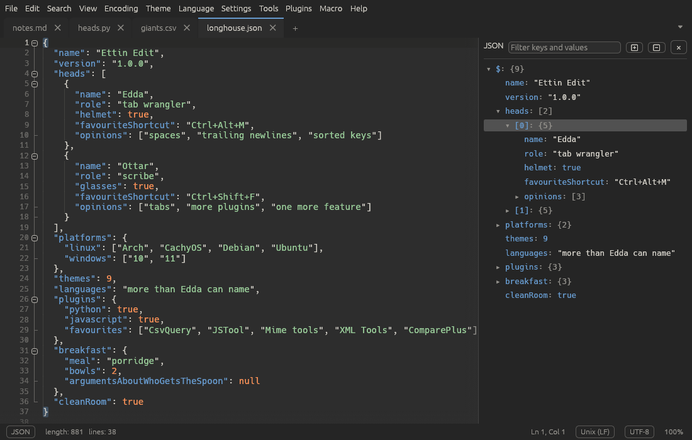

# A tour of the window

Ettin Edit draws its whole window itself, so it looks the same on Linux and
Windows and follows the colours of the theme you pick.

From top to bottom:

## The menu bar

| Menu | What's in it |
| --- | --- |
| **File** | New, open, save, recent files, print, rename, workspace folders, close |
| **Edit** | Undo, clipboard, line operations, case, comments, multi-select, completion, column editor, read-only |
| **Search** | Find, replace, Find in Files, marks, Go to Line, bookmarks |
| **View** | Word wrap, symbols, panels, split view, folding, zoom, distraction-free mode, the toolbar |
| **Encoding** | The encoding the file is saved in, or read it again in another one |
| **Theme** | Pick a theme, edit its colours, open the themes folder |
| **Language** | Pick the highlighting language, add your own languages |
| **Settings** | Preferences, the Shortcut Mapper, Customise Toolbar and quick on/off switches |
| **Tools** | Compare, CsvQuery, MIME Tools, JSON and JavaScript, XML Tools |
| **Plugins** | Your plugins' commands, and managing plugins |
| **Macro** | Record, play back and save macros |
| **Help** | This manual, update checks and About |

Under the menu bar is the [toolbar](toolbar.md): tabs of buttons for the
commands you use most. Right-click it to customise it, or press
<kbd>Ctrl+F1</kbd> to collapse it to its tab names.

The Ettin Edit icon at the far left opens **About Ettin Edit**, which shows
the version you have.

Right-clicking the text gives you the whole **Edit** menu, the **Tools**
menu and your plugins' commands, so you rarely need to go up to the menu
bar.

## Tabs

Each open file has a tab. A dot on a tab means it has unsaved changes, and a
pin means it's [pinned](files.md#tabs). At the end of the tab bar:

- **+** opens a new, empty tab (<kbd>Ctrl+N</kbd>).
- **⏷** opens the [tab list](view.md#tab-list), handy when there are more
  tabs than fit.

Right-click a tab for close, pin, split-view and file commands. Hover over it
to see the file's full path.

When the window is [split in two](view.md#split-view), each half has its own
tab bar.

## The find bar

<kbd>Ctrl+F</kbd> or <kbd>Ctrl+H</kbd> opens the find bar above the text.
See [Finding and replacing](search.md).

## The editor

The text itself, with the **gutter** on its left:

- line numbers,
- bookmarks (click the gutter next to a line, or press <kbd>Ctrl+F2</kbd>),
- fold markers: **−** folds a block away and **+** shows it again.

The editor highlights the current line, the bracket matching the one at the
caret, and other places where the selected word appears. Everything it shows
can be turned on and off in the **View** menu.

## Panels

Panels open beside the text and stay until you close them:

| Panel | Where | Opens with |
| --- | --- | --- |
| Folder as Workspace | left | **File > Open Folder as Workspace…** |
| Function List | right | **View > Function List** |
| Document Map | right | **View > Document Map** |
| JSON tree | right | <kbd>Ctrl+Alt+J</kbd> |
| Search results | bottom | **Find All** or **Find in Files** |
| XPath | bottom | <kbd>Ctrl+Alt+Shift+E</kbd> |
| CsvQuery | bottom | <kbd>Ctrl+Alt+Q</kbd> |
| Plugin panels | right or bottom | the plugin's own command |

Drag the edge of a panel to resize it.

## The status bar

On the left:

- **The language**, such as *Rust* or *Plain Text*. Click it to choose another.
- **length** (characters) and **lines** in the document.
- In XML files, **the XPath** of the element at the caret. Click it to copy it.
- **● Recording macro** while a [macro](macros.md) is being recorded.
- **Read-only** when the tab is read-only. Click it to allow editing again.

On the right:

- **Ln and Col**, the caret's line and column, followed by **Sel** (how many
  characters are selected) and how many carets there are, when that applies.
  Click it to [go to a line](search.md#go-to-line).
- **The line ending**: *Windows (CR LF)*, *Unix (LF)* or *Macintosh (CR)*.
  Click it to change the document's line endings.
- **The encoding**, such as *UTF-8*. Click it for the
  [Encoding menu](encodings.md).
- **The zoom level**.

## The command palette

Press <kbd>F1</kbd> anywhere. Type a few letters of any command, for example
`dup` for **Edit › Line Operations › Duplicate**, then press <kbd>Enter</kbd>.
Words can be in any order and needn't be complete, and each command shows its
shortcut, so the palette is also a good way to learn them.
