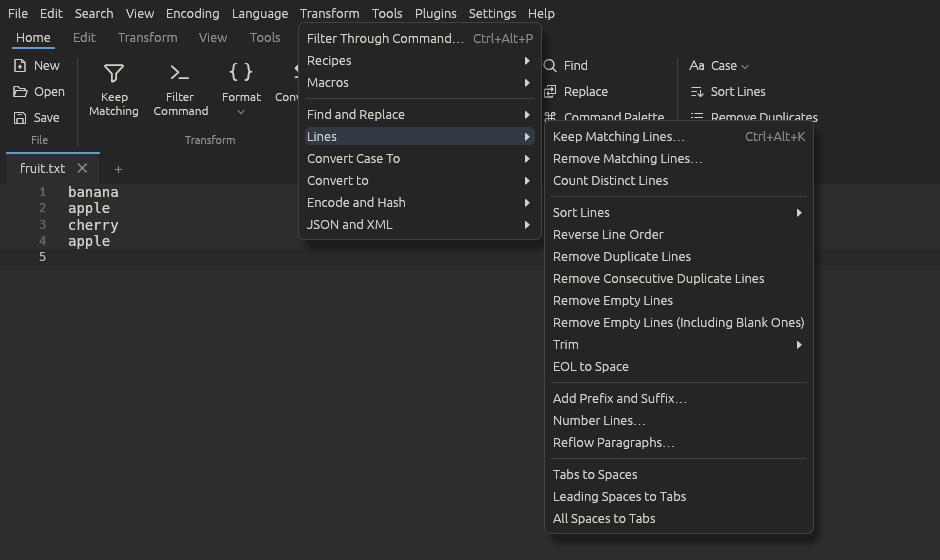
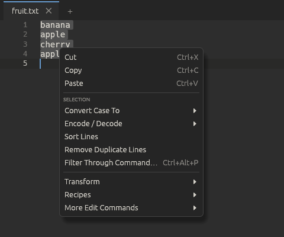

# Transforming text

The **Transform** menu holds everything that turns text into other text:
filter it through a shell command, sort, filter and number lines, change
case, convert data between formats, encode, decode and hash, and format JSON
and XML. Ettin Edit is built around it, so it is also the first thing on the
[toolbar](toolbar.md)'s Home tab and in the right-click menu.

Every command works on the selection (each one, if there are several) or on
the whole document when nothing is selected, and is one undo step. Commands
that work on lines take every line a selection touches, so you don't have to
select them exactly. If a command can't finish, a message says why and the
text is left as it was.

To run several of these commands one after another, again and again, save
them as a [recipe](recipes.md).

## The Transform menu

At the top:

- **Filter Through Command…** (<kbd>Ctrl+Alt+P</kbd>), described below.
- **Recipes**: run, record and manage [recipes](recipes.md).
- **Macros**: record and play back [macros](macros.md).

Then one submenu for each kind of transform:

| Submenu | What's in it |
| --- | --- |
| **Find and Replace** | **Replace…** (<kbd>Ctrl+H</kbd>), the [find bar](search.md) with the replace field |
| **Lines** | Keep or remove matching lines, count distinct lines, sort, reverse, remove duplicate and empty lines, trim, join, add a prefix and suffix, number, reflow, tabs and spaces |
| **Convert Case To** | UPPERCASE, lowercase, Title Case, Sentence case, iNVERT cASE, and the identifier cases |
| **Convert to** | JSON, YAML, TOML, XML, CSV and Markdown table |
| **Encode and Hash** | Base64, URL, Quoted-Printable, HTML and SAML ([MIME Tools](mime.md)), Text to Hex, Hex to Text, Decode JWT, and **Hash** |
| **JSON and XML** | Format, Minify and Sort Keys for [JSON](json.md); Format, Linearize, Escape and Unescape for [XML](xml.md) |

The groups are the same ones the recipe window's **Add Step** button offers,
so a step is where you'd look for it in the menu. A **Plugin Transforms**
submenu will list transforms that plugins add.

The **Tools** menu keeps the tools that look at text without changing it:
Compare, CsvQuery, JSON Tree, Validate JSON, the XPath panel, Check XML
Syntax, Validate XML and XSL Transform (which opens its result in a new tab).

### The right-click menu

Right-clicking in the text shows **Cut**, **Copy** and **Paste**, then the
commands that fit what you clicked:

- **On a selection**: Convert Case To, Encode / Decode, Sort Lines, Remove
  Duplicate Lines and Filter Through Command.
- **In a JSON file**: Format JSON, Minify JSON, Sort JSON Keys, Convert to,
  and JSON Tree.
- **In an XML file**: Format XML, Convert to, and the XPath Panel.
- **In a CSV file**: Open in CsvQuery and Convert to.

Below them are the whole **Transform** menu, **Recipes**, and **More Edit
Commands** (the rest of the Edit menu).

## Filter through a command

**Transform > Filter Through Command…** (<kbd>Ctrl+Alt+P</kbd>) sends the
text to a shell command and puts the command's output in its place. Anything
that reads standard input and writes standard output works: `sort -u`,
`jq .`, `column -t`, `awk '{print $2}'`, `python3 -c "…"` and so on.

- On Linux the command runs with `sh -c`; on Windows with `cmd /C`.
- It runs in the file's folder (your home folder for a new tab), and the
  environment variable `ETTIN_FILE` holds the file's path.
- The text goes to the command as UTF-8 with `\n` line breaks, and its output
  is read as UTF-8. When the selection doesn't end with a line break, a final
  line break in the output is dropped, so the text around it stays put.
- While the command runs, the dialog shows it with a **Stop** button. Nothing
  changes until it finishes.
- If the command fails (a non-zero exit code), the dialog shows its error
  output and the text stays as it was.
- **Recent commands** in the dialog lists the last 15 commands you ran.
- In the Flatpak, commands run on your computer outside the sandbox, so your
  own tools are found.

## Lines

**Transform > Lines**:

| Command | What it does |
| --- | --- |
| **Keep Matching Lines…** (<kbd>Ctrl+Alt+K</kbd>) | Keeps only the lines that contain the text you type, like `grep` |
| **Remove Matching Lines…** | Removes those lines instead, like `grep -v` |
| **Count Distinct Lines** | Opens a new tab with each different line once and how many times it appears, most frequent first, as `count`, a tab, then the line |
| **Sort Lines** | The sorts described below |
| **Reverse Line Order** | Flips the lines without sorting |
| **Remove Duplicate Lines** and the other Remove commands | Described below |
| **Trim** | Trim Leading and Trailing Space, Trim Trailing Space, Trim Leading Space |
| **EOL to Space** | Joins the lines with a space between them |
| **Add Prefix and Suffix…** | Adds text to the start and end of each line, for example `'` and `',` to turn a list into SQL values. **Skip empty lines** leaves blank lines alone |
| **Number Lines…** | Puts a number in front of each line: pick the first number, the step, the text after the number (`. ` by default), and whether numbers are aligned with spaces, padded with zeros, or neither |
| **Reflow Paragraphs…** | Rewraps paragraphs so no line is longer than the width (the long-line column from Preferences, unless you change it) |
| **Tabs to Spaces**, **Leading Spaces to Tabs**, **All Spaces to Tabs** | Use the tab width from Preferences |

The same commands are also in **Edit > Line Operations**.

The matching-lines dialog has **Match case** and **Regular expression**
options, and shows how many lines match as you type. Regular expressions use
the same syntax as [Find](search.md#regular-expressions).

Reflow joins the lines of each paragraph and breaks them again at spaces. A
paragraph ends at a blank line or at a list item (`-`, `*`, `+` or `1.`).
Indentation, comment markers (`//`, `#`, `>`, `--`, `;`) and list bullets are
kept, and continuation lines of a list item line up under its text. A word
longer than the width stays whole on its own line.

### Sorting and removing lines

Sorting, reversing and removing lines work on the selected lines, or on the
whole document when nothing is selected. Everything is one undo step.

**Sorting**, ascending or descending:

- **Lexicographically**: in character order, so `B` comes before `a`.
- **Ignoring Case**: `a` and `A` together.
- **As Integers** and **As Decimals**: by the number at the start of each
  line, so `9` comes before `10`. Lines without a number go first.
- **By Length**: shortest first.
- **Reverse Line Order** flips the lines without sorting.

**Removing lines**:

- **Remove Duplicate Lines** keeps the first copy of each line.
- **Remove Consecutive Duplicate Lines** only removes repeats that follow
  each other, like the Unix `uniq`.
- **Remove Empty Lines** removes lines with nothing on them;
  **Including Blank Ones** also removes lines that only hold spaces or tabs.

## Case

**Transform > Convert Case To** (also in the right-click menu on a selection,
and under **Case** on the toolbar's Home tab):

| Command | Shortcut | Example |
| --- | --- | --- |
| UPPERCASE | <kbd>Ctrl+Shift+U</kbd> | `HELLO WORLD` |
| lowercase | <kbd>Ctrl+U</kbd> | `hello world` |
| Title Case | <kbd>Alt+U</kbd> | `Hello World` |
| Sentence case | <kbd>Ctrl+Alt+U</kbd> | `Hello world` |
| iNVERT cASE | <kbd>Ctrl+Alt+Shift+U</kbd> | `hELLO wORLD` |

Below them are the identifier cases, which turn each line into one name.

### Identifier case

The identifier cases at the end of **Transform > Convert Case To** turn each
line into one name in a programming style. The words are
found wherever the text has spaces, punctuation, `_`, `-` or a change of case,
so `parse HTTP request`, `parseHttpRequest` and `PARSE_HTTP_REQUEST` all
become:

| Command | Result |
| --- | --- |
| camelCase | `parseHttpRequest` |
| PascalCase | `ParseHttpRequest` |
| snake_case | `parse_http_request` |
| kebab-case | `parse-http-request` |
| CONSTANT_CASE | `PARSE_HTTP_REQUEST` |

With nothing selected they convert the word at the caret, like the other case
commands.

## Converting data

**Transform > Convert to** converts between JSON, YAML, TOML, XML and CSV,
and writes Markdown tables. You only pick the format you want: **Convert to >
YAML**, **Convert to > Markdown table** and so on. Ettin Edit works out what
the text is in now, and the top of the menu says so ("Reading this tab as
JSON"). After a conversion the status bar says what happened, for example
*Converted to YAML (read as JSON)*.

How it tells: a tab whose language is JSON, YAML, TOML, XML or CSV is read as
that. Otherwise it tries JSON, XML, TOML, YAML and CSV in that order on the
selection (or the whole tab) and takes the first that fits. Because nearly
any text is valid YAML or CSV, YAML only counts when it is a list or a set of
`key: value` lines with plain keys, and CSV only when at least two lines have
the same number of commas (or tabs, semicolons or `|`).

The format the text is already in is greyed out, and so is everything when
the text doesn't look like any of them, such as a log file or prose. In a
very big file (over 2 MB) the format is worked out when you open the menu,
and a **Reading this tab…** line shows while that takes a moment.

**Convert to > Read as** picks the format yourself when the guess is wrong or
the text isn't one of the formats yet: **Auto** (the guess, shown in
brackets), **JSON**, **YAML**, **TOML**, **XML** or **CSV**. The choice is for
that tab, and goes back to Auto once the whole tab has been converted.

The **Convert to** button on the [toolbar](toolbar.md)'s Home tab opens the
same menu, and the **Convert** group on the Transform tab has the same targets
(**To JSON**, **To YAML** and so on), greyed out the same way.
In the [command palette](view.md#command-palette) they're called **Convert to
JSON**, **Convert to YAML**, and so on.

When the whole document is converted, the tab's language switches to the new
format; the file name doesn't change until you save it under another name.
Keys keep their order. JSON and XML are indented with the tab width and the
tabs-or-spaces setting from [Preferences](preferences.md).

How each format maps to the others:

- **YAML**: keys that aren't text (`1:`, `true:`) become text keys. A file
  with several documents (`---`) can't be converted in one go; select one.
- **TOML** needs a table at the top. A list becomes `[[item]]` tables. TOML
  has no null, so keys that are null are left out, and a null inside a list
  stops the conversion. Dates become text in the other formats.
- **XML to the others**: the root element becomes the one key at the top.
  Attributes become keys starting with `@`, repeated child elements become a
  list, text next to attributes or child elements goes in `#text`, and an
  empty element becomes null.
- **The others to XML** works the same way back. When the top isn't a single
  key, it's wrapped in `<root>`; keys that can't be element names have the
  odd characters replaced by `_`.
- **CSV to the others**: the first row names the columns, and each row becomes
  an object. The delimiter and quotes are detected as in
  [CsvQuery](csvquery.md); columns that are all numbers become numbers, but
  values with leading zeros, such as zip codes, stay text.
- **The others to CSV or Markdown**: a list of objects becomes one row each,
  with a column for every key that appears. A list of lists is used as it is,
  the first one being the header. An object that holds just one list is
  treated as that list. Values that are themselves lists or objects are
  written as JSON in their cell.

## Hashes

**Transform > Encode and Hash > Hash** has MD5, SHA-1, SHA-256, SHA-512 and CRC32.

- With a selection, each selection is replaced by its hash.
- With nothing selected, the hash of the whole document is copied to the
  clipboard and shown, and the text is left alone. It's worked out from the
  text in UTF-8 with the document's line endings, so for a UTF-8 file it
  matches `sha256sum` and friends.

Hashes are written in lower-case hex.

## Hex and JWT

In **Transform > Encode and Hash**:

- **Text to Hex** writes the text's UTF-8 bytes as hex pairs: `Hé` becomes
  `48 C3 A9`.
- **Hex to Text** reads them back. Spaces, line breaks, commas, colons and
  `0x` or `\x` in front of bytes are all fine. If the bytes aren't UTF-8 text,
  use [Hex View](view.md#hex-view) instead.
- **Decode JWT** turns a JSON Web Token (a `Bearer ` in front is fine) into
  JSON with its `header` and `payload`, and says when it was issued and when
  it expires, in your local time. The signature is not checked, so don't
  trust what a token says because it decoded.

## Encoding, JSON and XML

**Transform > Encode and Hash** has the [MIME Tools](mime.md) encodings and
decodings, and **Transform > JSON and XML** formats, minifies and sorts
[JSON](json.md) and formats, linearizes, escapes and unescapes [XML](xml.md).
Each is described on its own page.

## Macros and plugins

Transform commands are recorded in [macros](macros.md) with the settings you
chose in their dialog, so a macro repeats exactly what you did. **Filter
Through Command** is the exception: a macro never runs shell commands. Every
Transform command is also in the [Shortcut Mapper](shortcuts.md) and the
[command palette](view.md#command-palette).
